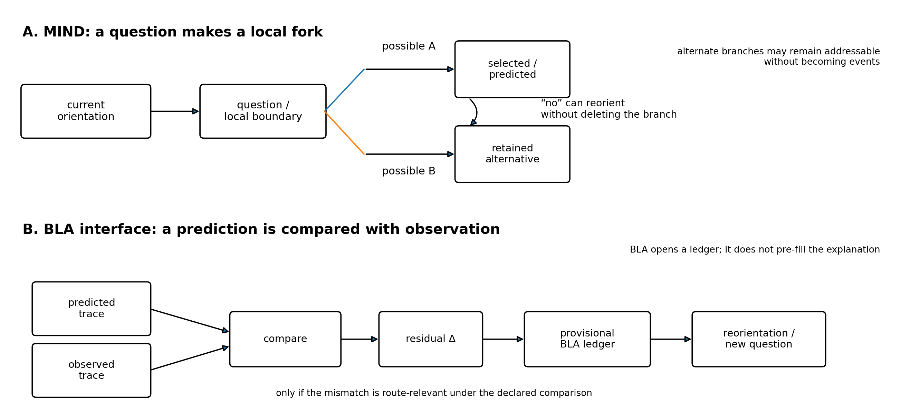

# MIND

## Matrix of Information, Negation, and Distinction

### A trace-based framework for meaning, attention, and open-ended understanding

**Christopher D. Pang**  
**v0.4 · 21 September 2026 · Publication-candidate draft**

**DOI: 10.5281/zenodo.22882309**

**Proposed placement:** the context stack of the author’s corpus; a separate PAL-informed research branch, not PAL v2.4.

> “Understanding is an open-ended ability to preserve distinctions and relations while allowing new constraints to revise where their boundaries lie.”

## Abstract

MIND proposes a framework for how a bounded system can acquire, carry, relate, and revise meaningful distinctions. Its starting point is not an inventory of completed thoughts, but a changing organization of information whose usefulness depends on context, attention, inherited trace, and encounters with constraint. The central term, **negation**, does not mean failure. It marks an evidenced change in what the current account can continue to treat as the same: something changed here, or a separation became available here. A task may succeed while producing such a distinction; a task may fail without producing a useful one.

The framework distinguishes an embodied system–environment boundary from a boundary of admission into a current integrated account. It treats perception, recollection, and simulation as differently sourced contributions rather than assuming their content alone reveals their origin. Attention selects contributions and allocates resolution; a wake preserves a relation between reference points; memory makes some of that wake retrievable. Understanding is located in warranted revision across encounters, not identified with a single representation or with a completed inventory of answers.

A question opens a local comparison boundary; a grounded “no” may reorient continuation rather than mark failure. Wake supplies two reference positions and a retained differentiating relation. Version 0.4 makes the locality of meaning explicit: significance can travel beyond an original task without becoming context-free, and recursive reinforcement does not become its own source of truth. A proposed CHARTER-based adapter separates preservation of a source account from applicability in a receiving context. Ambiguous or incompatible joins remain visible rather than being silently merged or discarded. Seven inherited elementary results and finite fixtures support the stated formal examples; comparative cognitive studies remain proposed. PAL supplies source, scope, trace, and reopening discipline. BLA and CHARTER retain their separate identities and claim limits.

**Keywords:** distinction; negation; question; orientation; wake; meaning; context; attention; trace; memory; imagination; deliberation; reasoning; understanding; intelligence; local meaning; transfer; PAL; BLA; CHARTER.

# Reading this draft

The conceptual center is unchanged: **“no” marks a distinction, not a failure.** Version 0.4 retains the question/fork, reorientation, and wake construction, and makes its cross-context discipline explicit: meaning stays situated while protected distinctions, conditions, and unresolved needs travel.

> **A question opens a fork. A “no” can reorient the route. A wake carries the difference forward.**

The capacity question remains: **how much relevant structure can the system keep available and use without losing the separations the task depends on?**

| Reading route | Main question |
|---|---|
| §§1–3 · Foundation | What gives possibilities addressable meaning, why does meaning remain local, and what can a check establish? |
| §4 · Negation | How can a question create a fork and a “no” reorient continuation without becoming failure? |
| §5 · Formal core | What do refinement and closed processing preserve? |
| §6 · Boundaries and deliberation | How can an event-like abstract boundary remain coupled to a continuously changing world? |
| §§7–8 · Attention, retrieval, imagination, and wake | What becomes available, what survives the turn, and what can be carried into another context? |
| §9 · Understanding and intelligence | How do reasoning, revisability, and effective distinction capacity differ? |
| §10 · Worked examples | What do the finite examples and the proposed MIND–BLA and MIND–CHARTER interfaces actually demonstrate? |
| §§11–13 · Research and conclusion | What would test the proposal, and what remains open? |
| Appendices A–C | Provenance, finite verification, and the v0.3 → v0.4 change record. |

**Evidence key.** Definitions and the new transfer adapter are branch-local proposals. Results 1–7 are retained from v0.3 without enlarging their premises or conclusions. Worked examples are stipulated constructions. References [8–11] remain limited later research comparisons; BLA [12] and CHARTER [14] are same-author sources with distinct roles, not independent corroboration. Finite checks examine the examples and adapter rules, not the proposed cognitive comparison. The latter has not been run.

The original thirteen-section organization is retained. New §§3.4–3.5, 8.7, and 10.7 develop the locality and transfer clarification. Earlier MIND editions remain unchanged. Appendix C records the revision; §12.1 separates publication preparation from future research.

# 1. The question: what gives possibility a usable shape?

The motivating image is an abstract center faced with every possible relation, but no usable distinctions through which to address them. Such an image suggests abundance without orientation: not too little possibility, but too little separation for a particular relation to mean something here. The expression “a slice of infinity” belongs to the exploratory dialogue. It is not a claim that a finite system stores an actual infinity, nor a mathematical construction of PAL’s Ω. [1, 6]

The counterintuitive proposal is that constraint can reduce the possibilities compatible with an encounter while increasing the structure available for subsequent thought. A formerly interchangeable pair becomes distinguishable. That distinction can enter a relation; the relation can itself become an object of later comparison. Imagination need not contain every thought in advance. A finite vocabulary can support further combinations, subject to the time, memory, and rules available to the system.

This is the sense in which what the dialogue called the world’s “no” gives abstraction a channel: an account registers a constraint, rather than nature literally issuing a judgment. The proposal does not require an adversarial world or an intelligence that learns only through mistakes. Resistance, confirmation, variation, recurrence, surprise, and correction can all make a previously unavailable separation readable. The relevant question is not whether an outcome feels positive or negative. It is whether the outcome changes a warranted distinction.

The framework’s name captures four roles. **Matrix** means an organized field of typed relations, not necessarily one numerical array. **Information** means source-bound content available to discriminate, connect, or revise within an account. **Negation** marks a warranted interruption of unchanged treatment. **Distinction** makes something separately addressable under a declared comparison. These are interacting roles, not four chronological rungs that every process must traverse in order.

The central research question is therefore:

> What organization lets a system retain enough of what happened to revise what matters, without confusing its current representation with a completed account of everything it represents?

The proposed definition of understanding on the opening page answers this at the level of an ongoing capacity. It is a working definition for MIND, not a theorem about all uses of the word. A finite question may be settled within a specified scope. That does not settle every later question, every representation of that question, or the source of the first witness from which the account began.

## 1.1 A question makes a local fork

MIND models an **operative question** as an event that opens a local comparison boundary. Before the question, several continuations may be present only as undifferentiated possibility relative to the current account. The question supplies an aperture under which at least two of them can become separately addressable.

For a question event $Q_t$, write

$$
Q_t=(q_t,\alpha_t,\mathcal P_t),
$$

where $q_t$ is the question, $\alpha_t$ the comparison aperture, and $\mathcal P_t$ the set of continuations the current account can distinguish under that aperture. The notation does not claim that every real question is binary or that the set is exhaustive. It records only the alternatives the account has actually made addressable.

The fork belongs to the account: naming two alternatives does not establish that either is physically possible, that they exhaust the options, or that evidence already separates them. A question can expose a distinction already present in inherited material. An ill-posed or underdetermined question can instead leave the comparison unresolved. The source of an admitted distinction remains a separate obligation.

A question therefore creates a **fork**, not truth. An answer may be exact relative to $q_t$ and $\alpha_t$ while the framing assumptions of the question remain contingent. “Yes” and “no” are orientations inside the supplied fork unless a stronger source separately warrants a broader claim. A perfectly answered question does not certify that the question was the only valid way to cut the problem.

The abstract boundary created by the question can be temporary. Once the comparison is answered, abandoned, superseded, or reopened, that local boundary need not remain the active boundary of the next moment. Its effects can persist through trace even when the fork itself is no longer current.

# 2. Source, scope, and the role of PAL

MIND’s immediate drafting lineage is the development dialogue and the v0.1 manuscript; the author also identifies decades of earlier personal inquiry as its intellectual background. [6, 7] Its conceptual commitments include the two-boundary proposal, the distinction between wake and explicit recollection, the joint selection-and-resolution role of attention, and the interpretation of “no” as distinction rather than failure. The mathematical objects and proposed study below are **draft formalizations** of those commitments. They are offered for review, not retroactively attributed to earlier PAL releases. [6]

PAL v2.3 remains the controlling reference for any PAL terminology used here. A supplied cut is not Ω; a record about a distinction does not manufacture its witness; a test result is evidence rather than automatic closure; and reopening preserves the prior account instead of rewriting its history. MIND’s unresolved register is a bounded software or conceptual record, not Ω or an exhaustive inventory of the unknown. Its equations are one realization of the proposal, not a container or replacement for PAL. [1]

The context-stack placement is particularly direct. *The Context Draws a Map* separates contextual force from evidentiary force and describes a local arrangement of tasks, claims, relationships, and possible continuations. *The Context Sets a Rhythm* separates a local pulse or reset from the history carried by the larger system and distinguishes retained context from parameter adaptation. MIND asks a neighboring question: **how does the map change when an encounter supplies a distinction, and what must the next moment inherit for that change to remain meaningful?** [2, 3]

The supplied A0/Software Boundary-Layer Kernel v0.10.0 is an implementation-status branch with a PAL v2.2 target, not a demonstrated v2.3 deployment. Its separation of proposal, diagnostic, authority, execution, and effect is useful implementation context. MIND’s attention gate does not replace that authority boundary: selecting a signal for consideration does not authorize an action based on it. [4, §§7–9, 12]

The earlier *Price of Spherical Closure* contributed a motivating distinction between a support and the patterns a representation asks it to carry. Its horizon interpretation is explicitly conditional. MIND imports neither a black-hole mechanism nor a topological theorem about cognition. Its two boundaries below are functional interfaces; they are not assumed to be literal spheres or manifolds. Legacy terminology in that supplied paper remains historical provenance rather than current PAL definition. [5, §§5, 9–12]

The supplied *Boundary-Ledger Accounting in Primitive Axiom Layers* v0.9.1 [12] is consulted only for its public-facing model-boundary mechanism: predicted trace, observed trace, route-relevant residual, provisional ledger, assessment, and bounded authority. MIND does not import BLA’s older primitive-floor wording as current PAL terminology; PAL v2.3 [1] remains controlling for Ω, A0, Ω*, θ, and trace. BLA enters this draft downstream, at the point where an enacted or otherwise observed trace can be compared with a represented prediction.

CHARTER v1.0 [14] supplies a further source interface: protected-query preservation, separately checked joins, typed unsuccessful returns, task-scoped semantic serviceability, and current-grant re-entry. Its geometric shell transport is not a general semantic transfer theorem. Section 8.7 states MIND’s proposed adapter to the relevant carriage discipline; it neither revises CHARTER nor treats its manuscript-level systems proposal as a deployed implementation. The immediate predecessor is the delivered v0.3 package [15].

**Status of this edition.** Definitions are stipulated; formal results hold only under their stated premises; finite calculations are illustrative; comparative studies are not run. Consciousness remains a motivating possibility of organized systems, not a property assigned to individual components or a required output of this model. The draft neither requires nor rules out a quantum realization. It leaves that realization question open while specifying mechanisms that can be investigated without first settling it.

# 3. Distinctions, measurement, and open meaning

## 3.1 A distinction needs an aperture

A distinction is always a distinction *for some comparison*. Two observations may be equivalent for shape, different for temperature, and unresolved for origin. MIND therefore attaches an **aperture** to each comparison: the domain, question, resolution, procedure, and limits under which sameness or difference is being considered.

For a declared domain $X$ and aperture $\alpha$, a readable distinction between $x$ and $y$ requires a specified way to discriminate them. In a simple deterministic realization, that can be a readout $f_\alpha$ with $f_\alpha(x)\ne f_\alpha(y)$. In an empirical realization it may require a tolerance, repeated measurement, or a calibrated uncertainty rule. In a formal realization it may be supplied by a proof or a counterexample. The draft does not identify all of these methods with one physical act of measurement.

A result must also distinguish **not established as equal** from **established as different**. Otherwise unresolved source information would manufacture a distinction merely by being absent. Conversely, two different labels do not establish two different underlying objects. A comparison has to retain what the labels denote and which differences its aperture can resolve.

The same discipline applies to relation. MIND does not deny that mathematics permits singleton structures or reflexive relations. Its claim is narrower: if an account cannot discriminate the relevant objects, it cannot responsibly attach different object-specific consequences to them merely because a richer description is imaginable.

## 3.2 Two routes through “can we measure it?”

The dialogue proposed two broad kinds of distinction: those with a checkable route, and those whose meaning remains open rather than exhausted by such a route. This draft makes that split relative to a **question**, not an immutable division of the universe into measurable and unmeasurable things.

| Route in the current account | What is available | What must remain separate |
|---|---|---|
| **Check-specified** | A procedure, formal rule, or observation can discriminate the stated alternatives within scope. | A successful check does not answer a broader question that the procedure never tested. |
| **Meaning-open** | The concept participates in interpretation and relation, but no adequate closure procedure has been supplied for the question as posed. | Absence of such a procedure is not proof of permanent unmeasurability or absence of meaning. |

A question about a predicted orbit can specify observations and tolerances. A question about a mathematical implication can specify premises and a proof rule. A question asking what love or experience *wholly is* may remain meaning-open, while narrower questions about reports, behavior, or physiological changes can be check-specified. Those narrower results do not silently replace the original question.

## 3.3 Meaning as a situated role

MIND does not attempt to define experience by finding a smaller experiential ingredient. It gives **operational meaning** a narrower role: what a distinction changes in the relations, expectations, interpretations, or available responses of a continuing account.

For a distinction $d$ in account $\mathcal M_t$, write

$$
\mu_t(d)=\operatorname{Role}(d;\mathcal M_t,\alpha_t).
$$

This is a definition placeholder whose realization must name the relevant tasks or interpretive comparisons. It is not a universal numerical measure of meaning. A pressure reading can matter as a contact event, a warning, a calibration datum, or a remembered encounter. Its value alone does not settle that role.

This permits the author’s starting intuition: an experience can establish the context in which its contents matter, without the framework pretending to stand outside that context and supply its entire meaning. The engineering object is the organized relation between event, inherited account, and later use.

## 3.4 Meaning remains local while its use can travel

Version 0.3 left a “universal account” of significance across contexts open. The author’s clarification changes the target: **locality is part of MIND’s account of meaning, not a defect to be repaired by making meaning context-free.** [6, 15] “Local” names the account, question, relationships, and conditions under which a distinction matters. It does not mean spatially tiny, private to one individual, or limited to one short task. A context can be shared, nested, long-lived, or broad in scope while still having identifiable conditions.

A significance learned in one task can inform another. What travels is not a guaranteed universal role but retained material together with some basis for using it again. In a source context $K_s$ and a receiving context $K_t$, the same addressable distinction $d$ can have roles

$$
\mu_{K_s}(d)\quad\text{and}\quad\mu_{K_t}(d).
$$

No equality is assumed between those roles. The same sound might serve as a warning in one learned account and as an expected operating cue in another. A transfer can preserve what the sound previously meant while leaving its present cause or relevance unresolved. Likewise, apparently conflicting readings can be compatible once their questions or conditions are distinguished. A genuine conflict under the same declared conditions remains a conflict; context is not an excuse to erase it.

MIND’s proposed transfer question is therefore: **what must survive, what may change, and what has not been established in the receiving context?** An operational realization names protected relations, source dependencies, permitted reinterpretations, relevant audience or task conditions, and reopening handles. It does not select one hidden objective function that silently makes every context commensurable. Section 8.7 supplies a bounded first adapter rather than a universal translator.

The remaining uncertainty can concern applicability rather than the local result itself. A relation can be exact under stated premises while its use in a different situation is not yet justified. MIND does not require an arbitrary nonzero doubt about every proved or checked local statement. It requires that local closure not erase its premises or become an unconditional claim about future cases.

> **Meaning can travel without becoming context-free. Local clarity can coexist with open applicability.**

## 3.5 Reinforcement does not become its own source

The author’s distinction is that recursive reinforcement can accumulate weight without becoming its own source of truth. [6] In a MIND realization, **influence within an account** and **warrant for a claim** must therefore remain separately represented. A relation may be made more available, more salient, or more influential by repeated use. Those are possible update effects, not additional observations of the thing the relation describes.

Re-reading a report, repeating its conclusion, and receiving copies derived from that report can create new processing events. Their wakes may matter for the system. But their evidential ancestry still points to the original source unless another basis is supplied. Repetition alone does not establish independence, authenticity, or applicability in a new context. A source identifier is an address, not an authentication proof. [1, 2; 14, §10.4]

This does not make derivation or repeated observation useless. A valid derivation may establish a previously uncomputed consequence of supplied premises; genuinely new observations may change support. Each increase in warrant must name what supplies it: a new observation, an explicit derivation, a changed comparison, or another relevant source. Source dependence and shared failure modes remain part of that account. Merely cycling the conclusion back as a premise does not pay this burden.

For example, a toy system might retain a use counter separately from a set of source dependencies. A hundred uses can raise the counter while leaving the source set unchanged. Neither field measures truth. The separation prevents a change in one field from being silently reported as a change in the other; the finite companion checks this limited record property in §10.7.

> **Reinforcement can strengthen an expectation. It cannot, by itself, erase the conditions under which the expectation was earned.**

An applicability handle can be brief: supported under these conditions; inherited through these sources; not checked under these changed conditions; reopen on this material change. It need not preserve every detail or force endless review. It preserves the question that remains open rather than hiding it inside an increasingly confident-looking summary.

# 4. Negation: “something changed here”

## 4.1 Not a failure flag

The phrase retained from the dialogue is [6]:

> “That ‘no’ doesn’t mean ‘failure’; it means ‘something changed here, there’s a distinction now.’”

MIND uses **negation** in this operational sense. It is not simply Boolean complement, verbal refusal, negative reward, or rejection of a task. It marks an evidenced reason why an account cannot continue a particular treatment unchanged.

The change may be in the monitored world, in the resolution of the observation, or in the account’s own interpretation. A newly resolved difference does not require that the world itself changed at that moment. A correction may instead show that a previous separation was unjustified. Accordingly, negation need not always split a category; it can also retract a split, revise a relation, or reopen a claim.

A proposed distinction event is recorded as

$$
n_t=(q_t,b_t,e_t,a_t,\alpha_t,\delta_t),
$$

where $q_t$ is the comparison question, $b_t$ the before-reference, $e_t$ the supplied evidence, $a_t$ the after-reference, $\alpha_t$ the aperture, and $\delta_t$ the warranted change. The after-reference may be a new classification or an explicit unresolved status. It need not be a final answer.

## 4.2 Four useful readings of the same event

**Environmental change:** a monitored quantity differs from its earlier value under a stable procedure. **New resolution:** additional observation separates alternatives that an earlier readout grouped together. **Interpretive revision:** evidence changes how the same retained observations should be classified. **Reopening:** a dependency or source changes enough that a previous conclusion can no longer be carried at its former strength.

These readings must not be collapsed. A sensor fault can change a reading without showing that the object changed. A new name can change a description without discovering a new object. A withheld answer can preserve uncertainty without establishing a negative physical fact.

The practical rule is to preserve the comparison and its source before evaluating the result’s desirability. “Failure” belongs to a separately specified task criterion; a person or protocol may define that criterion before the event. The event can be informative whether that criterion returns pass or fail.

## 4.3 Polarity is not information content

A positive result can be the decisive distinction: “yes, this response depends on that variable” may rule out many alternatives. A negative result can add nothing: repeating an already known refusal under unchanged conditions need not revise any relation. MIND therefore does not claim that every utterance of “no” creates new meaning, or that confirmation is inherently less informative than contradiction.

The intended claim is this:

> A grounded “no” becomes generative when it marks a change the account can retain and use. What matters is the newly warranted distinction, not the polarity of the sentence that reports it.

This also preserves a critical separation around human refusal. A person’s “no” can close an authorized route even when the action remains physically possible. That is an authority fact, not a measurement of physical impossibility and not an obstacle a learning system is entitled to work around. [4, §9]

## 4.4 Negation as reorientation

The question “what does a no add?” may be misleading. MIND does not require negation to add a new item. A grounded “no” can instead change the orientation under which already-addressable items are allowed to continue.

Let $o_t$ denote the current question-relative orientation of a candidate route. A branch-local reorientation operator may be written

$$
o_{t+1}=R_{n_t}(o_t),
$$

where $n_t$ records the basis for the change. $R$ is not required to be a geometric rotation; the notation means that the continuation rule, relation, priority, or admissible route changed while the underlying items may remain the same. A “yes” may carry the current orientation forward. A “no” may redirect, defer, narrow, or reopen it. A pause is one possible implementation of reorientation, not its definition.

This makes negation structurally generative without treating failure as a substance. The system can retain the rejected or deferred branch as an addressable alternative while changing which route currently receives continuation. The important evidence is the warranted change in orientation and the trace of why it changed.

The answer remains question-relative. A “yes” after reorientation does not become universal truth merely because the route now goes forward. It means that, under the present question, aperture, evidence, and authority, continuation is currently warranted. A later question can cut the same material differently.

## 4.5 Negation before enactment

An account can distinguish a possible continuation from what it will enact before that continuation occurs. **Prospective negation** is the branch-local name for that operation. The represented alternative remains an item in the account; its role changes. A route may be excluded from a current plan without being forgotten, declared physically impossible, or treated as an event that already happened.

This extends, rather than replaces, §4.1. An encountered distinction says that supplied evidence changes what can be carried forward. A prospective distinction uses inherited evidence, an inference, or an explicit condition to evaluate a represented continuation. Neither requires a negative reward or an unsuccessful experiment. Future planning is one use; hypothetical alternatives, present choices, and counterfactual interpretations also qualify.

The dialogue’s phrase “nature only has yes” is retained as a contrast between **occurrence** and **evaluation**, not a new proposition about physical law. The consideration is itself an implemented event. What need not occur is the event being considered. No nonphysical exemption is required for an account to represent alternatives.

For a represented candidate $p$, keep separate its content, evaluation basis, status for the current decision, and execution evidence. Useful evaluation statuses include *unassessed*, *excluded under the stated basis*, *deferred*, and *selected for proposal*. These are local decision labels, not PAL closure statuses or grants. Evidence that an action was actually performed belongs in a separately sourced record.

> **The future did not happen. Considering it did.**

A retained change caused by considering $p$ is a wake of the consideration. Its receipt can record the candidate, the assumptions consulted, the relation changed, and a reconsideration condition. It cannot honestly record the imagined execution as history. A simulation may therefore matter without having supplied a fresh observation of its represented world.

A human refusal and a prediction of failure are also different bases. “Not authorized,” “not selected,” “not feasible under this model,” and “not yet known” must not share one undifferentiated negative flag. A new prediction does not remove an authority boundary. The point of retaining an excluded alternative is accountable interpretation, not permission to circumvent a refusal. [4, §9]

# 5. The matrix and its update

## 5.1 A bounded relational state

One proposed finite realization is

$$
\mathcal M_t=(V_t,\mathcal R_t,K_t,\mathcal L_t,\mathcal U_t).
$$

$V_t$ is a finite set of addressable items: observations, concepts, claims, or reified relations. $\mathcal R_t$ contains typed relations among them. $K_t$ records the current comparison context, including source versions, protected questions, and resolution. $\mathcal L_t$ is retained lineage. $\mathcal U_t$ registers the unresolved needs that this account has actually identified. None is an inventory of every possible thought or relation.

A relation record contains its participating item references, relation type, aperture, evidence references, status, and reopening condition. A relation may become a new addressable item for higher-order comparison without thereby becoming true, complete, or authorized. This is **recursive addressability**: the account can talk about how its own relations are organized.

“Matrix” may be implemented as a graph, a collection of typed records, or several matrices exposing different relations. A scalar weight must not stand in for every kind of relation. In particular, salience, similarity, confidence, and authority are different fields with different sources.

## 5.2 From an encounter to a revision

Let $J_t$ be a bounded bundle of admitted evidence and $\nu_t$ the declared update rule. Then

$$
(\mathcal M_{t+1},\rho_t)=F_{\nu_t}(\mathcal M_t,J_t).
$$

The update returns both the revised account and a transition receipt $\rho_t$. A practical receipt names the before-reference, evidence, comparison rule, changed relations, preserved relations, lost or compressed detail, remaining uncertainty, and after-reference. An update can leave the substantive matrix unchanged while recording that the current evidence warranted no new distinction.

This is not an append-only guarantee for every byte of system state. The **history of material claims and revisions** is what must remain attributable within the retention policy. Storage may be compressed, migrated, or deliberately limited, but a loss of recoverability must not be presented as if nothing was lost. The distinction between a mutable working state and an immutable receipt history follows PAL’s source discipline. [1; 4, §§6, 10–11]

## 5.3 A refinement model

For an exact illustrative case, let $W$ be a supplied finite set of alternatives, $f_t:W\to Z_t$ the current readout, and $e_t:W\to Y_t$ a newly supplied observation. Define the equivalence relation

$$
\ker(f_t)=\{(u,v)\in W^2:f_t(u)=f_t(v)\}.
$$

The account presently treats alternatives in the same fiber as indistinguishable under this readout. If the next readout retains the old one and adds the new observation,

$$
f_{t+1}(w)=(f_t(w),e_t(w)),
$$

then

$$
\ker(f_{t+1})=\ker(f_t)\cap\ker(e_t).
$$

**Result 1 — refinement under retained observation.** The new readout cannot merge an old separation. It strictly refines the old partition exactly when some pair previously sharing a readout receives different new observations.

**Reason.** Two ordered pairs are equal exactly when both their components are equal. Strictness requires and is witnessed by an old-equal, new-different pair. This is an elementary property of paired readouts, not a new theorem of topology or a universal model of cognition.

This is one precise meaning of a productive “no”: the old readout cannot still treat that pair as interchangeable. But refinement is only one update profile. Correction, noise handling, changed scope, forgetting, and deliberate abstraction may require non-refining updates with their own receipts.

## 5.4 Closed processing and newly accessible consequences

Suppose instead that a new readout is only deterministic postprocessing of the old one: $g=c\circ f$. Then

$$
\ker(f)\subseteq\ker(g).
$$

**Result 2 — no new discrimination of aliased alternatives from that readout alone.** If $f$ gives the same input to $c$ for two alternatives, $c$ must return the same output. Processing may preserve distinctions or discard them, but cannot recover a difference absent from its complete input.

This does not say reasoning is useless unless a sensor fires. Reasoning can make previously uncomputed consequences accessible, reorganize distinctions, and reveal that a supplied premise excludes a candidate construction. That is a change in accessible representation or inference. It must be distinguished from learning which of two external alternatives is actual when the available observation aliases them. Additional source text, stored detail, random input, or changed measurement alters the declared input interface rather than violating the result. The same boundary discipline appears in the supplied kernel’s closed-processing profile. [4, §11]

# 6. Two boundaries, not two substances

## 6.1 Embodied coupling and the current account

MIND provisionally distinguishes two functional boundaries:

**The embodied boundary** separates an operationally specified system from the environment with which it exchanges signals, resources, and effects. The boundary is defined for a task or deployment; it is not a declaration that the system is physically isolated.

**The account boundary** separates what participates in a current integrated context from what is unavailable, unselected, unresolved, or outside that context. Contributions can come from fresh sensors, internal state, memory, communication, or simulation. In v0.3 this boundary is explicitly allowed to be **event-like**: a question can create a temporary inside/outside for one comparison without requiring an abstract center to be permanently enclosed.

The first concerns continuing coupling. The second concerns local organization. They are **separate in role but inseparable in a realized system**: the question-boundary can vary while the embodied system continues exchanging signals, resources, and effects with its environment. An abstract account does not earn a readable distinction merely by imagining one; the distinction must inherit or receive some usable basis. A software implementation can explicitly register both, while a biological realization would require its own observational definitions. A body-model is not identical to the physical boundary it models; a current integrated account is not identical to the whole body-model.

The dialogue’s “two centers” can be retained without treating them as two locations or substances. Let $B_t$ denote the relevant embodied state and $A_t$ the organized abstract account. Their coupling is a mapping or relation $\Gamma_t$, not an equality between unlike objects:

$$
\Gamma_t\subseteq\mathcal A\times\mathcal B.
$$

A bodily center of mass or gravity may be one reference in a particular realization. It is not required to be the location of an abstract center, and gravity is not assigned a universal minimum number of measurement axes. The model requires declared relations, not a special anatomical or geometric point.

## 6.2 A coupled-state sketch

A minimal engineering sketch can use an environmental state $E_t$, embodied state $B_t$, sensory bundle $s_t$, and action $u_t$:

$$
(B_{t+1},E_{t+1})=\Phi(B_t,E_t,u_t),\qquad s_t=H(B_t,E_t).
$$

Here $\Phi$ and $H$ are supplied realization-specific maps, not complete laws of an organism or universe. Their purpose is to make the feedback dependency explicit: an action can change later input, and an internal update can change how that input is interpreted.

The abstract account receives a bounded integration of those signals and retained material. It may represent a body, predict a response, or simulate alternatives. A disagreement between the represented body and the monitored coupling is a model discrepancy, not a violation of physical law.

The distinction between an “honest” and “dishonest” boundary is therefore implemented here as a distinction in records: whether the system preserves the difference between its estimate and the observed reference, or reports unsupported identity. This does not diagnose an internal intention. It specifies what an accountable interface must disclose.

## 6.3 Similar function, different channels

The proposal invites comparison between mechanisms that implement analogous sensing, retention, integration, and revision through different physical channels. It does not require that those channels be identical. Likewise, a simulation is physically executed somewhere, but its represented environment is not automatically the current external environment of its host. The frame in which something is simulated must be named.

The quantum, holographic, and black-hole images that helped motivate the dialogue remain possible interpretive directions, not hidden premises of these equations. The operative task is to assemble the functional relations before choosing which physical realization, if any, explains them best.

The author’s older image of “a big bang every moment” belongs to this imaginative background: a present comparison can open and then leave a trace rather than remaining an object held still. MIND uses the image to motivate event-like account boundaries, not to posit repeated physical Big Bangs or to derive a fact about the universe. [6]

## 6.4 Deliberation is a pause of commitment, not of the world

> **A pause suspends commitment, not consequence.**

Withholding one contemplated action does not imply stopping physical processing. A proposed realization can keep sensing, maintaining state, and performing already admitted background functions while an action candidate remains uncommitted. Deliberation occupies an interval in which both the system and its surroundings may change.

The development dialogue supplied an example: the author could have visited a professor immediately or fifteen minutes later with the same question and reason for asking. The two encounters need not have the same words, time, or outcome. For a declared purpose readout $g$, the relevant relation is simply

$$
e_1\ne e_2,\qquad g(e_1)=g(e_2).
$$

This is purpose-relative equivalence, not identity of physical histories. The reason for visiting may persist while the opportunity disappears. The resulting design rule is: **preserve the reason; recheck the conditions.**

Let $t$ mark a supplied physical-time coordinate over one bounded deployment, and $k$ an internal deliberation step. A candidate evaluated against context $K(t_0)$ may be proposed at $t_1>t_0$. Before an effect, a realization must recheck the dependencies on which that evaluation relied: the relevant observation, resource state, target, and any current grant. An unchanged intention does not establish unchanged feasibility or permission. A freshness interval is a declared rule grounded in the relevant dependency dynamics, uncertainty, and decision requirements; elapsed time alone does not prove that nothing material changed.

The distinction between $t$ and $k$ is bookkeeping for asynchronous updates, not a claim of a universal clock or a relativistic theory of cognition. A real implementation can attach different observation times and uncertainties to different channels. It must not treat “latest in the reasoning sequence” as “freshest in the environment.”

## 6.5 A finite budget for considering alternatives

A deliberating system is not supplied unlimited time, energy, memory, or opportunity. A bounded study should register a stopping rule, a resource budget, an interruption condition, and a permitted fallback. Stopping may leave a question unresolved; it does not require manufacturing certainty. An urgent response and the larger inquiry can have different finish conditions.

Shadlen and Shohamy [8] propose that some deliberative decisions can be understood through sequential retrieval of evidence from memory. Their account provides a relevant comparison for an occupied decision interval; it does not establish MIND’s full architecture or identify every pause with the same mechanism.

The suggestion that evaluating alternatives can have adaptive value is a hypothesis about a tradeoff: avoided costly actions or improved choices may outweigh the costs of consideration. MIND does not infer an evolutionary origin from that possible benefit. Its immediate engineering question is which amount and kind of deliberation improve a declared task under the actual resource and timing constraints.

# 7. Attention: selection, resolution, and source

Attention is assigned two distinct operations. **Selection** determines which contributions participate in a bounded update. **Resolution** determines which distinctions remain available within each selected contribution. The operations can interact: more detail in one channel can consume resources that might otherwise admit another.

A proposed attention interface is

$$
\mathcal G_t(s_t,m_t,p_t;\beta_t)=(z_t,r_t),
$$

where $m_t$ is retrieved memory, $p_t$ is prediction or simulation, $\beta_t$ the processing budget, $z_t$ the admitted bundle, and $r_t$ the record of consequential omissions or unresolved comparisons. This interface can consume multiple channels jointly. It is not an assumption that one computation can accept only one input, nor a requirement for one serial global queue.

For channels indexed by $i$, a simple resource model selects $a_i\in\{0,1\}$ and resolution $\ell_i$ subject to

$$
\sum_i a_i\,c_i(\ell_i)\leq\beta_t.
$$

The cost function $c_i$ must be specified for the realization. The equation expresses a budget constraint, not a neural law. Hardwired priorities, learned salience, and task-directed predictions can all influence selection without being identical mechanisms.

## 7.1 Perception and simulation are not distinguished by appearance alone

MIND requires the source path of a contribution to remain available wherever a later claim depends on it. An identical representation may be produced by fresh observation, recall, a simulation, or a report from another system. Content equality does not establish source equality.

The initial source classes are **observed**, **recalled**, **simulated**, **reported**, and **derived**. These labels describe acquisition or transformation, not automatic truth. A sensor can be unreliable, a recollection incomplete, a simulation useful, and a report well supported. A derived result inherits both its premises and the validity conditions of its derivation.

A mixed contribution should retain its relevant dependencies rather than receive whichever single label is most flattering. An old observation does not become fresh because it was recalled recently. A generated prediction does not become an external event because its wording matches what an observer might say.

## 7.2 Overload and the useful role of unresolved state

The “fog” described in the dialogue becomes a testable hypothesis about a bounded interface: when the demand for distinctions exceeds the supplied budget, a system may compress, omit, merge, delay, or substitute a prediction. Those operations have different effects on what later claims are warranted.

MIND proposes retaining the difference between **known equivalent** and **not presently separable**, and between **not selected** and **not present**. An unresolved item need not preserve the entire discarded signal. It should preserve enough identity, scope, and source information to say what cannot currently be answered and what could reopen it.

This is a proposal about trace organization, not an established explanation of any model’s hidden processing or a demonstrated improvement caused by PAL. Nor is unresolved state free: it costs storage and attention. A useful implementation needs bounded retention, expiration, retrieval, and privacy rules. Its value must be measured against those costs. [1–3]

## 7.3 What calls inherited material into use?

The new mechanism question is not answered by putting an inner agent named “intelligence” in charge of retrieval. A current sensation, question, goal, mismatch, or partial inference can provide a **cue**. An implemented association or lookup makes candidate material available; selection and further processing determine its use.

For a retained carrier $H_t$, inherited processing configuration $\psi_t$, current cue $c_t$, and context $K_t$, a proposed interface is

$$
D_t=\operatorname{Retrieve}_{\psi_t}(c_t,H_t,K_t;\beta_t).
$$

Here $D_t$ is candidate material, not an automatically admitted conclusion. Some inherited trace is addressable in $H_t$; some changes how the retrieval or update operation behaves through $\psi_t$. An explicit memory of acquisition is not required in either case. The symbol $\psi$ is a realization parameter, not a PAL primitive.

A reasoning step can produce a new cue, such as a request for a contrasting example. An unexpectedly retrieved item can change what is attended to. These are recurrent dependencies, not a mandatory sequence of modules. The realization must specify the association, search, cue update, and admission mechanisms; calling them retrieval is not an implementation.

Availability, selection, and warrant remain different. An item may be retrievable but unselected; selected but poorly supported; or well supported but unavailable before the decision deadline. A larger archive does not, by itself, solve any of those three problems.

# 8. Wake, memory, and continuing orientation

The dialogue’s “wake” is broader than explicit recollection. MIND uses it for a retained, attributable relation by which a later state can be oriented relative to an earlier one. The metaphor is useful because a wake does not contain the thing that made it; it contains a structured consequence of passage.

## 8.1 Minimum wake

The minimum working form is

$$
W=(b,\Delta,a),
$$

where $b$ is a before-reference, $a$ an after-reference, and $\Delta$ the retained differentiating relation that makes the later reference attributable to a change from the earlier one. It does not require two complete microscopic snapshots.

With only one reference there is a state but no wake. With two references and no retained relation, there are two states but no attributable orientation between them. The triad is therefore the smallest structure MIND currently needs to say **where the account has been relative to where it is now**. More demanding tasks can require source, timing, uncertainty, protected questions, or richer lineage.

This is a minimum of logical roles in the proposed definition, not a proven minimum of bytes, variables, duration, or conscious activity. One physical record can encode all three roles. Merely filling three fields does not establish their attribution: the retained relation still needs the source basis and comparison rule appropriate to its use. A no-change readout can also have an event trace, but no new difference at that readout should be invented.

A fuller wake record remains

$$
\omega_t=(b_t,e_t,a_t,\Delta_t,P_t,R_t),
$$

where $e_t$ is event evidence, $P_t$ the protected retrieval questions, and $R_t$ residual or lost detail. This extended record does not claim that every physical consequence is readable or permanently recoverable.

“Time writes receipts into matter” remains a useful image, but the engineering requirement is more precise: physical processes must leave a carrier, and a specified later operation must be able to use what that carrier preserves. Passage of time alone is not a storage guarantee.

## 8.2 Ω-shadow is not the wake

PAL v2.3 keeps the primitive roles separate. $A_0$ is the supplied cut, Ω* the cut-indexed reflection, $\theta$ the minimum trace-bearing turn, and later PAL layers earn readable or recoverable consequences under their own requirements. [1]

MIND therefore does **not** identify Ω* with wake. The useful interpretive bridge is:

> **Ω-shadow is a picture of the asymmetry that starts a wake, not the wake itself.**

In that picture, the supplied cut admits the asymmetry, Ω* reflects its other-side relation, $\theta$ records that a turn occurred, and wake is the downstream retained relation by which a later state can inherit that orientation. This is a MIND-to-PAL reading aid, not a new PAL primitive or a claim that every Ω* realization generates a MIND wake.

The picture must not be read as a map out of Ω, a literal photograph, or evidence of temporal origin. Ω remains unresolved and is not an input to a constructor. A readable depiction of the reflection needs its own A1-level witness; recoverable consequence needs A2-level support, and an explicitly retained typed relation invokes the relevant A3 obligations. The wake definition does not make those downstream capabilities free. The question/fork is a MIND comparison event, not automatically PAL’s A0.

## 8.3 Memory is a retrieval capability over retained wake

Memory need not reproduce the source event exactly. For a protected question set $P$, a memory mechanism is adequate only to the extent that its retained representation supports the declared retrievals. A summary may preserve a task’s stopping condition while losing the original wording. Changed parameters may influence later behavior without permitting retrieval of a particular earlier episode. Both can be retained consequences, but they support different claims.

**Result 3 — protected-question preservation.** Let $\mathcal H$ be a declared history domain, $c:\mathcal H\to C$ a compression, and $q:\mathcal H\to Q$ a protected question. Exact recovery of $q$ from the compressed representation is possible precisely when there is a decoder $d$ on the reachable compressed values such that

$$
q=d\circ c.
$$

Equivalently, histories sharing a compressed representation must agree on the protected answer. If two such histories disagree, no deterministic decoder receiving only that representation can answer both correctly. This is an elementary factorization condition, closely aligned with the supplied kernel’s reachable-image and compression discipline. [4, §11]

## 8.4 Continuity is not perfect copying

For MIND’s functional purposes, continuity means that a later account inherits the relevant orientation, dependencies, and unresolved needs from a predecessor under a declared recovery rule. It does not require unchanged weights, a complete context transcript, or continuous execution. Conversely, a similar output without attributable inheritance does not establish that continuity.

Teleportation, upload, and replacement thought experiments motivated the question; they are not observations that settle personal identity. The bounded engineering question is which protected relations survive an interruption, reconstruction, or change of carrier. *The Context Sets a Rhythm* provides an adjacent reason to keep this local: an actuator’s reset does not imply that the scheduler, environment, or retained context also reset. [3]

## 8.5 Imagination inherits material without merely replaying it

The continuation selected this working sentence:

> **The construction inherits distinguishable material and constraints from somewhere, whether or not their acquisition is presently recalled.**

MIND treats imagination as constructing arrangements that need not have occurred. Its inputs may include remembered episodes, learned concepts, embodied regularities, acquired procedures, communicated descriptions, and earlier generated models. This is a provenance requirement on the declared construction, not a claim that every detail can be traced to one explicitly remembered sensory episode. Opaque or unknown acquisition remains identified as such.

In one finite realization,

$$
\mathcal C_t=\operatorname{Construct}(D_t,K_t;\Pi_t,\Lambda_t,\beta_t),
$$

where $D_t$ is available material, $\Pi_t$ lists relations to preserve, and $\Lambda_t$ specifies what may be varied or provisionally relaxed. Each retained candidate records its actual dependencies and changed assumptions. The construction produces a bounded candidate set, not an inventory of all possible thoughts.

A hypothetical world can suspend an ordinary physical constraint without denying the observations from which that constraint was learned. The assumption changes inside the hypothesis; the historical receipt remains intact. Recombination can expose consequences not previously computed without identifying an external alternative that the available evidence does not distinguish. Result 2 still applies to the complete declared input.

Schacter, Addis, and Buckner [9] describe a research account in which remembering and imagining recruit overlapping resources, with stored material supporting prospective construction. This is a later scientific comparison, not the origin of MIND’s claim. MIND’s scope is broader than future episodes: an invented object, a counterfactual past, a mathematical example, or a reinterpretation of the present may also be constructed.

## 8.6 Precision and expansiveness

Precision asks which task-relevant separations a construction preserves or resolves. Expansiveness asks how many meaningfully different arrangements it can examine under a declared variation rule. Neither is simply more words or more candidates. Diversity requires a comparison criterion; accuracy requires a reference and tolerance.

A useful correction can improve both. “No bridge of this kind works” may be an overbroad rule; distinguishing material, span, and load can identify a narrower failure condition while reopening other arrangements. Section 10.3 makes this a stipulated finite example, not a claim about bridge engineering.

Madore, Addis, and Schacter [10] found that an episodic-specificity intervention improved a divergent-thinking task in their experiments. This supports investigating an interaction between detailed retrieval and generative range. It does not establish that more detail always increases creativity or that the present formal definitions measure it.

For an implementation, the proposed operation is: **choose what to preserve, choose what to vary, and retain the distinction between the two.** The choice remains constrained by purpose, resource limits, and the status of its evidence; imagination is not automatically a recommendation to act.

## 8.7 Cross-context carry: a bounded CHARTER adapter

CHARTER already distinguishes carrying a representation from deciding what it means, retaining evidence from reproducing a result, and accepting local returns from accepting their join. Its protected replacement edges preserve declared queries; its selected-carry contract records omissions and unresolved duties; and a task-scoped translation can return an explicit non-success status. [14, §§14.2, 15.3, 16.6–16.10] MIND uses those distinctions here without importing the geometric shell-to-shell transport theorem as a semantic theorem.

**Source contract versus new adapter.** The source contracts belong to CHARTER v1.0. The assignments of MIND meaning-bearing items, the following paired-query interface, and the worked transfer fixture are v0.4 proposals. No implementation of the full CHARTER orchestration or a universal procedure for choosing meaningful correspondences is claimed.

### 8.7.1 Preserve the source account; reassess its use

A proposed transfer declaration identifies the source and receiving contexts, the item or projection being carried, its lineage, a finite protected-query family, the mapping/decoder version, and the allowed purpose and destination. It separately names the dependencies and conditions needed for use at the destination. Any effect uses a current external grant rather than permission inferred from successful translation.

These are two different checks:

| Check | Question | What passing does not establish |
|---|---|---|
| Protected carriage | Can the receiving carrier answer the specified questions about what was carried, including its source and former conditions? | That the old interpretation applies unchanged now. |
| Contextual applicability | Does the declared receiving task have a supplied basis for using or reinterpreting that material here? | That every other context must agree, or that an action is authorized. |

For one exact profile, let $x\in X_s$ be the source carrier and $y\in X_t$ the candidate receiving carrier. Each protected pair has partial readouts $q_i^s:X_s\rightharpoonup V_i$ and $q_i^t:X_t\rightharpoonup V_i$. The common answer type $V_i$, any unit or symbol mapping, and the query correspondence are supplied, not inferred from similar wording. Define

$$
\operatorname{Preserved}_i(x,y)\iff
q_i^s(x)\downarrow\ \land\ q_i^t(y)\downarrow\ \land\ q_i^s(x)=q_i^t(y).
$$

The down arrow means that the requested answer is available under the declared readout and retrieval route. This is a bounded adaptation of CHARTER’s preservation condition, not a claim of global equivalence between contexts. A tolerance-based profile must name its tolerance and comparison instead of silently using exact equality.

Both queries returning an “unknown” placeholder does not recover a missing substantive answer. By contrast, a separately protected question asking *what uncertainty status was recorded* can have the definite answer “unknown,” provided that status record is actually retained. Preserving the unresolved marker and resolving the underlying question are different achievements. [14, §15.3]

A changed target interpretation can coexist with exact preservation of the source interpretation. The carrier can say “this was accepted under the earlier rule” while the receiving account says “this is outside the current rule.” The latter is a new, sourced classification, not an edit of the earlier receipt. Byte or symbol round-trip success alone cannot establish semantic serviceability.

### 8.7.2 Do not force the disputed join

CHARTER’s proposed Gloss interface distinguishes `TRANSLATED`, `AMBIGUOUS`, `UNMAPPED`, and `GENERATION_MISMATCH`. Its readable-return lane distinguishes `CANDIDATE_COMPLETE` from `OWL_SUPPORT_REQUIRED(reason, residual)`. The second is still a terminal return, but it is not readable success. Its join has obligations of its own; accepted components do not automatically make an accepted whole. [14, §§16.6–16.10]

MIND’s adapter therefore records, for each protected comparison, whether it is preserved, mismatched, or unevaluable. It records applicability and required dependency status separately. A conflict is not resolved by averaging claims, privileging the most repeated version, or deleting the disputed item from the reported coverage.

A required join remains uncommitted if its preservation, applicability, version, or dependency checks fail or remain unresolved. Independent comparisons may continue only when the declared dependency contract permits them to stand on their own. An all-or-none bundle must not be retrospectively recast as partial success merely because one required component failed. This permits **local noncommitment without concealed incompleteness**.

The rejected or ambiguous candidate can remain addressable with its sources and reopen handle. It need not be loaded as an accepted claim. Preserving two conflicting reports as reports is compatible with withholding a unified conclusion. When the declared task actually requires choosing an action, it also needs its own decision rule, deadline, permitted fallback, and authority; storing a conflict does not itself settle the decision.

### 8.7.3 Serviceability has a lifetime

CHARTER’s selected carry fixes task, audience, authority epoch, objective epoch, expiry, and destination. Its Translation Board retains a mapping reference while semantic serviceability expires at task closure; successor use needs current checks and authority. [14, §16.8] For MIND, this directly prevents “it carried meaning before” from being cast as “it carries the same meaning here.”

A subsequent context may reuse the old source trace, re-evaluate the correspondence, or leave the item unresolved. It does not create fresh observation by recalling an old one, renew an expired grant, or rewrite the previous interpretation. Where an external retrieval path is required, its availability and cost remain part of the transfer contract.

**Adapter ceiling.** The paired-query test checks only the chosen protected relations. Choosing those relations, judging contextual applicability, and deciding which conflicts are material remain supplied, contestable responsibilities. The new example below implements a small deterministic instance, not CHARTER’s full role choreography or an empirical cognitive model.

> **Carry what the source supports. Reassess what the destination asks. Keep the disputed join visible.**

# 9. Understanding belongs to revision, not one snapshot

The working definition remains:

> **Understanding is an open-ended ability to preserve distinctions and relations while allowing new constraints to revise where their boundaries lie.**

Preserving a relational structure while changing representation is useful, but not sufficient for this definition. A translator can preserve every relation in a frozen model while remaining unable to revise that model when its assumptions fail. A system can also revise incessantly without understanding in the proposed sense if its revisions destroy warranted distinctions or follow unsupported suggestions.

The capacity therefore requires both **retention** and **answerability to constraint**. Neither is subordinate to permanent growth. Revision can add detail, restore an older distinction, retract a false separation, simplify a representation, or hold a question unresolved. More entries are not automatically more understanding; fewer entries are not automatically less.

**Result 4 — a snapshot underdetermines revision behavior.** Consider two update rules that agree on the current representation and every transformation so far observed. Let one preserve that representation on a new decisive input and the other revise the challenged relation while retaining the rest. The current snapshot does not distinguish those rules, although the next encounter does. Therefore a static representation, by itself, does not identify the update capacity MIND calls understanding.

This is a constructed counterexample to a proposed criterion, not a general impossibility theorem. A snapshot containing an independently specified update program can support further analysis. Similarly, a trace contains multiple references only if their relationships are actually represented; putting the word “trace” into a state description does not supply them.

## 9.1 Open-ended does not mean never locally complete

MIND rejects total self-certification by a current account. It does not infer that no finite theorem, task, or measurement can be completed. A relation can be closed under its current question and still possess a material reopening condition. A system can also finish a task and stop; open-ended capacity does not impose endless activity.

PAL v2.3-L keeps O04 and O25 as distinct historical interfaces to D-FIRST-OCCURRENCE: respectively the ontic inhabitance/source interface, and the certificate/revocation and witness-nonmanufacture interface. MIND does not close that debt by positing an abstract center or a sufficiently rich receipt. Nor does the open debt prohibit ordinary local inference from supplied premises. [1, Ledger §12]

The appropriate contrast is not finished versus intelligent. It is **scoped completion with preserved limits** versus a completed-looking account that cannot represent what would legitimately change it.

## 9.2 Reasoning, understanding, and intelligence

The three working roles introduced in v0.2 remain distinct rather than interchangeable.

| Term | Proposed MIND role | What does not suffice |
|---|---|---|
| Reasoning | Drawing and examining consequences from available distinctions, relations, and assumptions. | Fluent phrasing, or a conclusion without its required premises. |
| Understanding | Preserving relevant relations while allowing warranted constraints to revise their applicability and boundaries. | A frozen translation or indiscriminate acceptance of corrections. |
| Intelligence | The capacity to acquire, select, combine, and revise useful distinctions across changing situations and resource limits. | A raw count of stored items or a single successful answer. |

These are proposed functional descriptions, not three anatomical modules or a new universal psychometric definition. They can interact in one process. Retrieval supplies candidates; reasoning examines consequences; understanding concerns their applicability and revision; intelligence describes broader effective coordination and adaptation. A relation may be understood in a narrow domain without establishing general competence elsewhere.

Language can carry reusable inferential structure: roles, conditionals, temporal order, quantification, and contrast. “Jo received the book from Sam” specifies more than the occurrence of three names. But a linguistic carrier can also preserve a mistaken premise or express an invalid inference. The claim that language supports reasoning is not the claim that all reasoning is language. Monti, Parsons, and Osherson [11] found distinguishable patterns for logical and linguistic inference in their task comparison, alongside shared supporting activity.

The author’s “no” matters here as a constraint on applicability, not a requirement that every act of understanding follow a personal mistake. A proof, demonstration, contrast, or hypothetical variation can show that changing one condition changes the conclusion while changing another does not. Understanding is then tested by what the system preserves and revises when those conditions vary.

## 9.3 Effective distinction capacity

The refinement adopted in the dialogue is:

> **Intelligence may depend less on how many distinctions a system possesses than on how many relevant distinctions it can preserve while changing what it does with them.**

A large parity lookup table and a short remainder procedure illustrate why inventory is not enough. The table may encode more explicit cases, while the procedure answers a new case within its computational limits. Conversely, a compact rule that drops an exception can be worse than a larger record. Counts depend on representation; usefulness depends on the declared question and operation.

MIND therefore proposes **effective distinction capacity** as a task-relative research construct: the relevant structure a system can make available and use, within stated resources and time, without losing protected separations. This is one aspect to investigate in intelligence, not its definition by a single number.

Four capacities should be reported separately: material retained somewhere; material accessible through retrieval; material currently admitted to the working account; and material effectively usable for the present decision. A context-window budget is an implementation constraint on the third, not a guarantee of the fourth. External storage can help only when the relevant material is retrievable and interpretable within the episode’s budget. Its latency, index, and reconstruction costs belong in the comparison.

A capacity profile should record protected-question coverage, error, preservation across recoding or compression, response to warranted revision, transfer to changed questions, and resource cost. An always-unresolved system has low useful coverage even if it rarely makes a false claim. Repeating the same record under many names must not inflate the profile.

The mechanism’s essential comparison is therefore not “how many tokens fit?” but **which distinctions still support their required uses when the next question arrives?** No empirical claim about a particular deployed model is made by posing that question.

## 9.4 A finite preservation test and representation bound

Let $\mathcal H$ be a nonempty finite set of supplied histories and $\mathcal P=\{q_1,\ldots,q_m\}$ a finite, nonempty family of protected questions. Their reference answers are defined in the fixture, not discovered by the notation. Write

$$
Q_{\mathcal P}(h)=(q_1(h),\ldots,q_m(h)),\qquad
N_{\mathcal P}=\operatorname{card}(Q_{\mathcal P}[\mathcal H]).
$$

Here $\operatorname{card}$ counts distinct elements and $\operatorname{ceil}$ denotes rounding upward to the next integer.

A retained capsule $c:\mathcal H\to C$ is the entire history-dependent information available to a fixed decoder at the registered checkpoint. Query identifiers and fixed rules may be supplied, but hidden history-dependent memory may not. The capsule is formed before the choice of which protected question is asked.

**Result 5 — joint protected-question preservation.** Every $q_j$ can be recovered exactly from $c$ if and only if

$$
\ker(c)\subseteq\ker(Q_{\mathcal P}).
$$

**Proof.** If all component answers are recoverable, two histories with the same capsule must agree on every answer, hence on the answer vector. Conversely, if each capsule fiber has a single answer vector, assign that vector to its reachable capsule value; projecting a coordinate recovers the requested answer. This extends Result 3 from one question to a fixed family.

**Result 6 — finite encoding lower bound.** Under those premises, $\operatorname{card}(c[\mathcal H])\geq N_{\mathcal P}$. If the capsule is a fixed-length classical binary string of $b$ bits, then

$$
b\geq\operatorname{ceil}(\log_2 N_{\mathcal P}).
$$

**Proof.** Two different protected-answer vectors cannot share a capsule. At least $N_{\mathcal P}$ reachable capsule values are therefore required, and $b$ fixed-length bits provide at most $2^b$ values. This is a pigeonhole bound, not an intelligence score, neural law, or new coding theorem.

**Result 7 — semantic recoding invariance.** Bijectively recoding capsule values preserves their kernel. Duplicating a protected question or bijectively renaming its answers leaves the induced history equivalence unchanged. Thus exact preservation and $N_{\mathcal P}$ do not improve merely because labels or duplicate records are added.

**Proof.** A bijection preserves and reflects equality. A duplicate coordinate imposes a condition already present in the tuple; a bijective coordinate recoding does not change which histories agree.

These results do not establish an efficient decoder. An index, program, retrieval service, or source reread may restore missing information, but it changes the complete available interface and has to be budgeted. Separately answering different questions with different retrievals does not demonstrate that all required distinctions were jointly available at one checkpoint. No universal scalar ordering of systems follows.

## 9.5 Improvement as traceable reorientation

A change from “no” to “yes” can reflect improved understanding, but the polarity change is not itself the improvement. The same is true of “yes” becoming “no.” MIND counts the stronger case when the account can preserve **what distinction changed the orientation** while leaving unaffected relations intact.

A local progression may be written

$$
N_{old}\rightarrow D\rightarrow R\rightarrow Y_{new},
$$

where $D$ is the newly warranted distinction and $R$ the reorientation it causes. $Y_{new}$ does not become truth outside the question that licensed it. It records that the route is now carried forward under the revised question-relative account.

This gives a candidate local criterion for improvement, to be evaluated under declared questions and costs rather than a universal intelligence score: revision is better when it preserves warranted structure, changes the relation that the new distinction actually bears on, and retains enough trace to explain why the orientation changed.

# 10. Worked examples

## 10.1 Fewer candidates, more structure

Consider a supplied finite domain $W=\{a,b,c,d\}$. Initially, all four alternatives have the same visible readout. Two additional binary observations are available. The labels and observations are stipulated; this is not a physical experiment.

| Alternative | Initial readout | Observation $x$ | Observation $y$ |
|---|---:|---:|---:|
| $a$ | 0 | 0 | 0 |
| $b$ | 0 | 0 | 1 |
| $c$ | 0 | 1 | 0 |
| $d$ | 0 | 1 | 1 |

The initial partition is $\{\{a,b,c,d\}\}$. Observation $x$ refines it to $\{\{a,b\},\{c,d\}\}$. Retaining $x$ and adding $y$ yields four singleton classes. The numbers of distinguishable unordered pairs are respectively **0, 4, and 6**.

For one actual alternative, receiving $x=0$ narrows the compatible candidates from four to two. Receiving $y=0$ then narrows them to $a$. At the same time, the joint readout gives the model a richer discriminating structure over the original domain. These are different counts: **remaining candidates for this observation** and **distinctions supported by the readout across alternatives**. Their opposite movement is not a paradox.

In MIND’s language, the first warranted negation is not “the task failed.” It is “the old single class cannot remain the whole account of these alternatives.” The next one is “the two items still grouped by $x$ can now be separated by $y$.” A repeated observation of the same $y$ adds no new partition distinction in this exact fixture, although a new observation event can have its own trace.

Now suppose a compact summary retains only $y$. Then $a$ and $c$ share a summary, as do $b$ and $d$. The protected question “what was $x$?” cannot be recovered from that summary alone. The summary is still useful for questions about $y$; it is not lossless for every question the earlier account could answer.

Finally, rename the four joint outputs with arbitrary symbols. If the renaming is one-to-one, the same distinctions survive. This demonstrates representation preservation. It does not tell us how a system will respond when a later observation challenges the classification. That is why transport belongs inside understanding rather than defining the whole of it.

**Verification status.** The companion standard-library script checks these finite claims by enumeration, including refinement, repeated-observation idempotence, preservation under bijective recoding, and failure of the stated compression to preserve $x$. These checks validate the supplied finite example, not an agent implementation or an empirical claim about cognition.

## 10.2 A context capsule that preserves content but loses its source

Consider eight stipulated histories formed from three binary coordinates: source is *observed* or *simulated*; the represented result is *ready* or *not ready*; and its recorded age class is *fresh* or *stale*. The three protected questions ask for those coordinates. Age is a fixture label here, not a universal validity judgment.

| Capsule | Reachable values | Exactly recoverable protected answers |
|---|---:|---|
| Content alone | 2 | Result only; not source or age. |
| Content repeated one hundred times | 2 | The same result only. |
| Source, content, and age tuple | 8 | All three. |
| One-to-one recoding of that tuple | 8 | All three, with the decoder. |

The joint answer map has eight values, so an exact fixed-length capsule for all three questions needs at least three bits under Result 6. Repeating “ready” cannot recover whether it came from a simulation or observation. The compact tuple is sufficient for these questions but not for a newly introduced question about, for example, which sensor generated an observation. A changed question can require a changed retention policy.

A reference to an external record is useful only with a working retrieval path. When the source cannot be retrieved before the decision, the reference does not silently contain its answer. The honest disposition is a limited answer or an unresolved need, rather than a guessed source. This makes context compaction an operational test of MIND’s capacity proposal.

## 10.3 Narrower constraint, broader construction

A second toy domain has eight combinations: two materials, two spans, and two loads. Stipulate that exactly one combination is excluded by the fixture rule: material A with a long span and a heavy load. This is invented task data, not a physical engineering recommendation.

An overbroad provisional rule excludes every material-A combination, leaving four candidates and falsely excluding three admissible ones. A supported revision that identifies the joint condition leaves seven candidates and makes no such error in this fixture. Its classification is more precise while its admitted design set is larger.

The example shows possibility, not inevitability: a finer description can improve both precision and expansiveness when it replaces an overbroad constraint. Other refinements can shrink the feasible set or consume excessive resources. The reported counts depend on the stipulated reference rule and do not prove that complexity is beneficial in general.

## 10.4 The same purpose after a delay

In a small decision fixture, a proposed route is evaluated in environment epoch 0. The purpose is retained while a simulated deliberation step moves the environment to epoch 1 and changes a dependency. The prior evaluation must be rechecked before proposal under the new conditions. The candidate remains represented even when no action is recorded.

The fixture distinguishes three facts: the purpose was preserved; a consideration occurred; the contemplated external action did not occur in the fixture. None is inferred from the other. Its outcome illustrates “preserve the reason; recheck the conditions,” not a deployed concurrency or authorization guarantee.

## 10.5 Humor as a small interpretive example

The conversation proposed the comic Rule of Three as a way to inspect expectation and distinction. Two items can establish a provisional pattern; a third can redirect it while preserving a recognizable connection. The anticipated continuation may never be spoken, yet it can contribute to the actual line’s interpretation.

For example: “I checked the claims, checked the references, and checked whether the references were also me.” The third item redirects the review routine toward the source of its own support. In MIND terms, the relevant change is between interpretations, not a failure of the sentence to communicate.

This is an illustrative reading of one construction, not a general humor theory or a claim that surprise is always necessary. Familiar jokes may still depend on recognizing a contrast even when their arrival is expected. Humor remains an optional example of revisable interpretation, not an empirical pillar of the framework.

## 10.6 From question-fork to boundary-ledger

The small fork diagram used during development exposes a natural interface between MIND and BLA without merging them. MIND acts upstream: a question makes alternatives addressable, an orientation selects or predicts a route, and alternate branches can remain represented without becoming events. BLA becomes relevant downstream when a predicted trace and an observed trace can actually be compared. [12, §§3–7, 22, 24–29]

**Figure 1 — Question, orientation, and boundary repair.** Panel A is a MIND schematic: a question creates a local fork; “no” may reorient without deleting the alternate branch. Panel B is the proposed interface to BLA: prediction and observation feed a declared comparison; a route-relevant mismatch opens a residual and provisional ledger; the ledger does not pre-fill the explanation.

A compact combined route is

$$
Q\rightarrow D\rightarrow O\rightarrow P\rightarrow E\rightarrow C\rightarrow\Delta\rightarrow L\rightarrow O',
$$

where $Q$ is question, $D$ distinction, $O$ orientation, $P$ prediction, $E$ sourced observation of an event or effect, $C$ comparison, $\Delta$ residual, and $L$ provisional ledger. Not every MIND event traverses this whole route. If no external trace is compared, BLA need not enter. If the observation agrees within the declared uncertainty, no boundary-residual is manufactured merely to keep the loop moving.

This crosswalk also preserves a useful asymmetry: **MIND can branch without the unrealized branch becoming physical history; BLA requires an observed comparison before a residual earns ledger status.** A future BLA revision may adopt or reject this interface on its own authority. Version 0.3 of MIND merely records the proposed seam.

For this interface, prediction and observation must share a declared comparison domain, units or types, dependency versions, and an uncertainty rule. A mismatch within the expected variation need not open a model-repair ledger; an unresolved comparison is not a measured residual. BLA’s LRA names assessment and its LRC records the draft’s model-support status. That legacy “authority” vocabulary does not supply permission, consent, or an execution grant. A residual can motivate a new discriminating question while its explanation remains open.

## 10.7 Local meaning, repeated sources, and an uncommitted join

This fixture uses invented intervals and records. It is not an engineering safety recommendation. A historical observation has value 7, source `sensor-A`, and epoch 0. Under source rule `lab-v1`, the inclusive acceptable range is [4, 8], so the recorded source classification is “inside.” The receiving task is to classify that same historical sample under `target-v2`, whose inclusive range is [4, 6]. Its target classification is “outside.”

The source value, source identity, epoch, rule version, and original classification can all be preserved exactly. Yet the new classification differs because the question changed. That difference is not a contradiction, a corruption, or evidence that the original event changed. Nor does the historical sample answer a new question about the current physical reading.

| Case | Carriage and target facts | Fixture disposition |
|---|---|---|
| Exact historical carrier; declared `target-v2` | Source protected answers preserved; target comparison specified. | Reclassification may be admitted for this historical-sample query. |
| Carrier drops the source identity | The numeric value survives; one required source question is unevaluable. | Withhold the required transfer; do not report it as fully preserved. |
| Two purported target rules; no resolved active version | Both reports can be retained, but the target rule for this query is unresolved. | Withhold the target classification; no vote by repetition. |
| Substitution of a different retained value | At least one protected answer mismatches. | Report the mismatch; withhold the required join. |
| A separate query asks only what number was recorded | Its declared dependency is the preserved value, not the disputed target rule. | That independent historical query may be answered without declaring the target classification complete. |

The companion enumerates all 27 combinations of three preservation outcomes—preserved, mismatch, and unknown—and admits the all-required preservation step only for the all-preserved combination. It then varies target readiness and declared dependencies to distinguish withholding one join from stopping every independent question. Acceptance here names a finite fixture result, not an execution grant or a CHARTER conformance claim.

A separate reinforcement record starts with one source identifier and increments a use counter one hundred times. The use count becomes one hundred; the source-dependency set still has one member. Adding another identifier changes the set but does not prove the second source authentic or independent. This checks separation of record roles, not a quantitative model of confidence.

Finally, a later target epoch makes the old applicability check stale in the fixture. Reassessment appends a new record; it does not alter the source classification or the original context. The wake belongs to the comparison and revision that actually occurred. The example therefore brings together locality, source-preserving carry, reorientation, and a visible unresolved join.

# 11. A bounded research programme

The first comparative question is whether preserving source, unresolved distinctions, and material revision history improves a system’s handling of changing contexts compared with equally resourced alternatives. The experiment should not assume that the MIND name itself produces a benefit.

## 11.1 A proposed four-condition comparison

Use the same base model or controller, the same task stream, the same observation access, and matched storage and processing budgets. Cross two factors:

| | Explicit unresolved relations | Single provisional commitment |
|---|---|---|
| **Source and revision lineage retained** | Full proposed MIND condition | Tests whether lineage alone suffices. |
| **Matched current-state summary without that lineage** | Tests whether uncertainty alone suffices. | Conventional compact-state comparison. |

The single-commitment condition is an experimental representation constraint, not a claim that existing systems universally behave this way. Add a simple conventional typed-record baseline where feasible. If that baseline matches MIND, report equivalence at the tested scope rather than attributing special power to new terminology.

Construct finite episodes in which identical content arrives from different sources; a coarse category is later split by an observation; a report is corrected; a source becomes stale; a valid local conclusion is repeated; or a compression removes the detail required by a later question. Keep observation order and source dependence explicit. A repeated report from one origin is not independent corroboration.

## 11.2 Outcomes that matter

Measure warranted separations and merges, unsupported source promotions, recovery of protected answers, response to corrective evidence, preservation of unaffected relations, and storage and latency costs. Test transfer to episodes not used to choose the update rules.

A system that calls everything unresolved can avoid many errors while answering nothing. Comparisons must therefore report useful coverage and error together, including performance at matched coverage. Likewise, a system that always revises can look responsive while merely following noise. Include unsupported corrections and verify that they do not automatically overwrite stronger evidence.

The programme’s strongest useful outcome would be a reproducible improvement attributable to a specified mechanism: source binding, selective retention, an explicit unresolved state, or a better revision rule. A null or negative result would still be informative. It might show that metadata costs outweigh benefits, that ordinary uncertainty tracking already supplies the relevant function, or that a proposed distinction cannot be operationalized reliably.

## 11.3 Decision consequence and stopping rule

For each study, specify in advance which result would retain, alter, or reject the tested mechanism. Do not count more tests, larger logs, or longer deliberation as improvement by themselves. Stop when the finite episode budget is exhausted and the results have been incorporated into a revision record, or when a concrete dependency blocks the comparison.

No comparative cognitive study is reported in v0.4. The immediate next research action is the finite context-transfer pilot in §11.4; its matched conditions have not yet been implemented or run. Public deployment, collection of personal sensory data, and consequential actions require their own separate authorization; this manuscript supplies none.

## 11.4 The next pilot: context pressure and protected distinctions

The first proposed pilot should remain small: one finite task family with source, content, age, and corrective-evidence distinctions. Cross the two representation factors in §11.1 under several preregistered context budgets. Hold source access, base system, task order, query family, stopping policy, and total resource accounting constant; record storage and retrieval separately rather than pretending equal token counts imply equal total work.

At a registered checkpoint, form each condition’s retained state. Then reveal a held-out query or material update. Some episodes require source rather than content, some require distinguishing a considered action from an observed one, and some require revising only the affected relation. Add distractors and bijective relabelings; include duplicate records that add no evidence. The condition labels should be hidden from outcome assessment where feasible.

Measure correct useful coverage, error at matched coverage, source-promotion mistakes, unaffected-relation preservation, stale-evaluation reliance, latency, and retained size. Distinguish information that is unavailable from information that is present but unused. Where an external archive is permitted, give all conditions the same archive access and charge the actual retrieval cost.

A receipt-rich condition may fail because overhead crowds out useful content. A concise conventional record may match or exceed it. Either result should revise the proposed mechanism rather than be explained away by the MIND label. The finite checks in Appendix B are not this pilot: they check the stipulated examples and elementary identities only.

Version 0.4 makes the transfer cases more explicit without claiming that they have been tested in agents: a source classification may be retained while target applicability changes; duplicate reports may share one origin; and a required join may be withheld while an independently answerable historical query proceeds. Their fixed reference conditions can be included in the same finite task family. Correct preservation, warranted reinterpretation, and unjustified promotion should be scored separately; a fluent target answer is not enough.

## 11.5 Later contrasts, not an expanded first run

After that pilot, separately registered comparisons could vary deliberation delay and environmental change, or vary the retrieval of specific detail while measuring distinct and valid constructions. They should not be combined into an unbounded search for a favorable result. A later study should test whether reasoning performance, revision behavior, and transfer under resource limits dissociate as the proposed definitions suggest.

Any human-subject study, personal-data collection, live action, or deployment requires a separate design and authorization. No such activity is initiated by this draft.

# 12. Open obligations and conditions for revision

Version 0.4 separates adopted scope commitments, draft definitions, source-based adapter proposals, and unperformed research. A clarified definition does not close its empirical or implementation burden. The dispositions below do not amend PAL, BLA, or CHARTER.

**Negation beyond ordinary update — REFINED / EMPIRICAL DISTINCTIVENESS OPEN.** Negation’s proposed role remains reorientation rather than adding a special object. Existing methods may realize the same function. Equivalent performance under matched source, retention, and resource conditions would support MIND as an organizing synthesis rather than a uniquely effective mechanism.

**Minimum wake — WORKING DEFINITION SUPPLIED.** The triad $(b,\Delta,a)$ supplies the three logical roles. Attribution, the comparison rule, and task-specific protected retrieval remain required. It is not a universal minimum of storage or a sufficient account of personal identity.

**Two boundaries — REFINED / REALIZATION OPEN.** Embodied coupling and event-like account admission remain different roles in one realized system. A realization must show what keeping them distinct explains or enables.

**Meaning across contexts — LOCALITY EXPLICIT / ADAPTER SPECIFIED / VALIDATION OPEN.** Local significance is the scope commitment, not a missing universal quantity. Section 8.7 specifies a first CHARTER-based adapter for protected carriage, receiving-context applicability, and unresolved joins. Particular mappings, protected-query selection, conflict judgments, and their usefulness still require realization-specific evidence. No context-free significance or universal semantic reconciliation is claimed.

**Recursive reinforcement — SOURCE SEPARATION EXPLICIT.** Repeated use can change an account without supplying another observation or independent corroboration. New warrant must have an identifiable basis. Reliable tracking of source dependence and costs in deployed systems remains open; the finite fixture only checks the declared record behavior.

**Improved understanding — REFINED / UNIVERSAL ORDER NOT CLAIMED.** A warranted, traceable reorientation that preserves unaffected distinctions is a candidate local criterion. A change from no to yes or yes to no is not sufficient by itself. Evaluation still needs declared questions and costs.

**Effective distinction capacity — ABSOLUTE SCALAR REJECTED / PROFILE COMPARISON OPEN.** Capacity remains relative to a supplied question family, aperture, decoder, and resource budget. The exact finite encoding results do not settle efficient use, approximate recovery, or fair cross-system comparison.

**Prospective exclusion and deliberation — REFINED / DOMAIN RULES OPEN.** A simulated consequence, proof, preference, and refusal remain different bases. A pause suspends commitment, not consequence. Applicability, freshness, stopping, fallback, and action authority must be supplied for the actual use; no universal deliberation interval is proposed.

**MIND–BLA interface — PROPOSED.** Prediction and sourced observation must share a comparison domain and uncertainty rule before a route-relevant residual motivates a provisional ledger. A ledger does not select its explanation. BLA v0.9.1 is not revised or designated v1.0 here.

**MIND–CHARTER interface — BOUNDED ADAPTER / FINITE FIXTURE ONLY.** Protected-query preservation, typed unsuccessful returns, and join obligations are source mechanisms. MIND’s mapping of its meaning-bearing items into those roles is the new proposal. The script is not the full CHARTER implementation, a formal conformance certificate, or a general conflict-resolution algorithm.

The draft should reopen when it confuses missing evidence with evidence of difference; promotes an answer outside its aperture; counts repetition as independent support; treats unknown substantive answers as exact preservation; silently discards a required conflict; reuses stale serviceability; erases historical interpretation; or claims an empirical benefit that disappears under matched resources. A proposed correction appends its basis rather than rewriting the earlier warrant.

## 12.1 Publication sufficiency is not research finality

This edition is prepared as a **publication-candidate draft**, not an already deposited or independently reviewed release. The declared publication claim is a conceptual synthesis, seven bounded elementary results, and reproducible finite illustrations. Comparative cognitive benefit, deployed CHARTER behavior, universal meaning, and a substrate theory are not claims a reader must accept in order to inspect that contribution.

For that scope, inconsistent definitions, an unsupported source attribution, an incorrect stated result, a failing claimed fixture, or missing disclosure of a known material limitation would block presenting the affected claim as ready. Unperformed empirical studies and later refinements remain explicit research obligations rather than being concealed or used to require endless polishing. This distinction follows CHARTER’s release-sufficiency discussion without borrowing publication authority from it. [14, §15.5.2]

Final adoption of the manuscript, license selection, and deposit metadata belong to Christopher D. Pang. The author supplied DOI **10.5281/zenodo.22882309**; this package uses it as the intended publication identifier, not evidence that a deposit has occurred. The open-obligation and preparation notes accompany the manuscript so that a final publication decision can name its exact scope.

# 13. Conclusion

MIND treats information as something that must become addressable, situated, and carried before it can participate reliably in later relations. The question/fork construction makes the initiating event explicit: **a question creates a local fork**. The fork does not manufacture truth. It provides a bounded frame in which alternatives can become distinguishable.

Within that frame, “yes” can carry an orientation forward and “no” can reorient it. Negation therefore need not be modeled as a failure or as an additional object. Its useful content lies in the warranted change of relation, direction, scope, or commitment. The alternate branch can remain addressable even when it is not enacted.

Wake gives that turn continuity. In its minimum form, two reference positions and one retained differentiating relation are enough to say that the later account is oriented relative to the earlier one. PAL’s Ω* is not that wake: it is the cut-indexed reflection whose asymmetry can be pictured as beginning the route; $\theta$ is the trace-bearing turn; MIND’s wake is the downstream retained consequence.

The two-boundary picture also sharpens. Embodied coupling continues while question-boundaries appear, dissolve, and reopen. A deliberative pause can change which action is committed without freezing the world around it. **A pause suspends commitment, not consequence.**

The framework now has a proposed downstream seam with BLA. MIND can represent forks that never become events. When a represented prediction is actually compared with observation, a route-relevant mismatch can open a BLA residual and provisional ledger. The ledger can then supply the next constraint that reorients MIND’s map.

A compact recurring picture is therefore:

$$
\text{question}\rightarrow\text{fork}\rightarrow\text{orientation}\rightarrow\text{wake}\rightarrow\text{next question},
$$

with the optional scientific comparison route

$$
\text{prediction}+\text{observation}\rightarrow\text{residual}\rightarrow\text{ledger}\rightarrow\text{reorientation}.
$$

Version 0.4 gives this loop a cross-context discipline. A meaning may be retained, reconstructed, or reinterpreted without becoming context-free. Recursive reinforcement can change its role within an account without becoming the source of its truth. CHARTER supplies protected-carriage and join disciplines; MIND’s adapter separates what survived from whether it applies here. A disputed join can remain uncommitted while its sources, uncertainty, and dependencies stay visible.

> **Meaning can travel without becoming context-free. Reinforcement can accumulate without becoming self-grounding.**

Understanding remains the open-ended ability to preserve distinctions and relations while allowing new constraints to revise where their boundaries lie. Intelligence is not reduced to the number of distinctions stored, but investigated through how much relevant structure can remain available and usable while those revisions occur.

> **“No” is not necessarily where the work failed. It may be where the route first acquired a new direction.**

# Appendix A. Provenance and source roles

## A.1 Development trace

This draft was requested after an exploratory dialogue on 20 September 2026. The route began with spherical closure and the difference between a boundary’s support and what can be represented on it. It moved through the two-center and two-boundary proposals, embodiment, attention, perception and simulation, wake, and recursive abstraction. A proposed definition of understanding as representation preservation was rejected as insufficient. Revision under new constraint then became central. [6]

The name **MIND** was suggested by Christopher D. Pang. “Matrix” and “Information” were among the candidate expansions he supplied. An AI assistant proposed the complete expansion, **Matrix of Information, Negation, and Distinction**, which Pang explicitly adopted. Pang then clarified that negation meant a new change or distinction, not failure. This manuscript preserves that clarification rather than treating “Negation” as a synonym for error.

The accepted working sentence defining understanding emerged in the same assisted dialogue and was explicitly selected by Pang. Version 0.2 follows his further distinctions among reasoning, understanding, and intelligence and his acceptance of the refinement about preserving relevant distinctions while changing their use. The added equations, examples, and pilot design are drafting realizations, not retrospectively attributed statements by the author before this dialogue.

Pang describes the longer background as decades of personal inquiry and internal debate, informed by listening to Alan Watts, Richard Feynman, other physicists, George Carlin, Bill Hicks, and others. These are author-reported intellectual influences, not claimed sources for particular formal results, endorsers, or independent witnesses. His recalled college discussion about the same intention at a different clock time is motivation, not an independently documented experiment. No earlier unpublished paper is reconstructed here.

The comic examples, the distinction between occurrence and prospective evaluation, and the finite cost of deliberation arose in the continuation. Version 0.3 then added the question-as-fork formulation, negation-as-reorientation, the minimum wake triad, the event-like account boundary, the “pause suspends commitment, not consequence” rule, and the PAL Ω*/θ/wake crosswalk. The author supplied BLA v0.9.1 after noticing that the fork diagram might provide a useful interface to boundary-ledger accounting. The framework’s conceptual genealogy remains separate from literature or prior artifacts encountered afterward; later comparisons can inform or challenge the account without being rewritten as its historical cause.

Version 0.4 follows the author’s clarification that significance is always local to an account and that recursive reinforcement cannot become its own source of truth. The subsequent CHARTER review located protected transfer, typed ambiguity, separate join checks, and expiring semantic serviceability in an existing same-author source. The author then requested v0.4. The source contract is inherited; the MIND adapter and its finite fixture are newly drafted realizations. The earlier fasciation/vacancy image remains an exploratory analogy for withheld commitment, not a biological premise or a CHARTER rule. The author supplied the MIND DOI during this continuation. [6, 14, 15]

## A.2 Source-role register

| Source | Role here | Limit of use |
|---|---|---|
| PAL v2.3 suite [1] | Supplied-cut, source, receipt, local-closure, and reopening discipline. | MIND is a branch proposal, not a new PAL release or conformance claim. |
| *The Context Draws a Map* v1.0 [2] | Contextual organization and the separation of contextual force from evidence. | Conceptual context, not empirical validation of MIND. |
| *The Context Sets a Rhythm* v0.1 [3] | Retention across pulses and local resets; context versus parameter adaptation. | Its results do not automatically transfer to the MIND update model. |
| A0/Software Boundary-Layer Kernel v0.10.0 [4] | Typed update records, source/authority separation, compression and execution limits. | Supplied author-review draft with a PAL v2.2 target; not a finished deployment. |
| *The Price of Spherical Closure* [5] | Historical geometric motivation for representation limits. | No inference from spherical topology to a physical theory of mind. |
| Development dialogue [6] | Conceptual origin, author selections, and continuation through v0.4. | Exploratory conversation and author-reported history, not an empirical experiment. |
| MIND v0.1 [7] | Earlier manuscript predecessor; definitions, Results 1–4, finite fixture, and study structure. | Preserved under its original version; not independent corroboration. |
| MIND v0.2 [13] | Earlier manuscript predecessor; prospective negation, deliberation, retrieval, imagination, Results 5–7, and the capacity profile. | Preserved unchanged; not independent corroboration. |
| BLA v0.9.1 [12] | Question-specific abstraction, residual comparison, provisional ledger, and assessment. | The exact supplied `BLA in PAL(8).pdf` remains unchanged. Legacy primitive and authority wording is not promoted into current PAL or action permission. |
| MIND v0.3 [15] | Immediate delivered predecessor; seven results, 38 finite checks, question/fork, wake, and BLA interface. | The packaged source is used; earlier artifacts remain unchanged. |
| CHARTER v1.0 [14] | Protected queries, join checks, typed return, local serviceability, re-entry, and release sufficiency. | Systems contracts retain their source status; MIND’s adapter is not a CHARTER revision or a semantic transport theorem. |
| Later comparisons [8–11] | Specific neighboring research on deliberation, constructive memory, creativity, and linguistic/logical inference. | Limited comparison, not origin attribution, a systematic review, or validation of MIND. |

The source account for [1–5] is carried from v0.1 and the source passages already retained in this conversation: the Spine’s receipt and closure grammar, the Compatibility Note’s migration rules, Ledger §12 on D-FIRST-OCCURRENCE, and the stated context-stack and branch limits. No new whole-corpus audit is claimed. The predecessor source account is retained rather than re-created. At v0.3 completion, the supplied v0.2 package, its companion, and the interrupted v0.3 manuscript were available directly; protected source and predecessor byte identities are recorded in this package’s source register. One author’s related papers and one dialogue lineage are not independent corroboration.

The v0.1 bibliography established conceptual lineage rather than an external literature review. Version 0.2 retained that lineage and added four narrow external comparisons already raised during development. Version 0.3 adds BLA v0.9.1 as a same-author branch source for predicted/observed trace comparison, residuals, and provisional ledgers. Its legacy PAL primitive wording is not imported as current authority. The set is not a systematic literature or priority review. Full comparisons with belief revision, model-based planning, concept learning, working-memory theories, and embodied cognition remain open. Novelty is proposed within the author’s corpus; global priority is not asserted.

For v0.4, the delivered v0.3 ZIP is the authoritative predecessor package. Its PDF and DOCX match the standalone delivered files. The standalone Markdown still reflects the interrupted edit and differs from the packaged Markdown; the packaged version, which includes the completion clarifications, is used here. Both identities are recorded without overwriting either source. CHARTER’s Library copy is pinned by byte digest; the relevant carriage and lifecycle sections were retrieved in the development dialogue. No fresh external literature review or publication-status verification is claimed. The four later research comparisons are retained with their original consultation limits.

## A.3 Authorship and release status

Christopher D. Pang is the author, originator of the framework direction, and accountable steward. Hearthline was used as an AI assistant for terminology, synthesis, source retrieval, formalization, finite checks, and document preparation. AI assistance is part of the development trace, not co-authorship or an independent source of authority.

Version 0.4 is a publication-candidate draft for final author review, not a new PAL release. DOI 10.5281/zenodo.22882309 was supplied by the author. Its inclusion does not assert public deposit or independent verification. No license is selected by this drafting step; final license, adoption, and publication remain the author’s decisions. This edition does not revise BLA or CHARTER.

# Appendix B. Finite verification note

The companion `MIND_v0.4_finite_checks.py` uses only the Python standard library. It runs the exact inherited `MIND_v0.3_finite_checks.py` from the package’s `inherited` folder and preserves its 38 checks. The inherited source and original receipt remain byte-identical. Twelve v0.4 assertions exercise the declared locality-and-transfer fixture: exact historical preservation with changed target interpretation; missing and mismatched fields; unknown-status versus substantive-answer preservation; all-required joins; independent queries; unresolved mapping versions; same-source repetition; and stale applicability without history editing.

The inherited checks cover Results 1–7 and the stated finite examples. The added assertions do not introduce an eighth cognitive theorem. They check the finite predicates defined for §§8.7 and 10.7, including all 27 combinations of three preservation outcomes. The paired-query equation adapts a source contract; it does not discover which semantic relations deserve protection.

**Executed result:** 50 named finite assertions passed in the recorded v0.4 run: 38 inherited and 12 added. The 38 inherited result records match the v0.3 receipt. The current receipt records script digests, interpreter, fixture results, and execution-environment time; the clock is not a trusted time attestation. Existing receipts are not overwritten by the supplied command.

A failed assertion invalidates the corresponding claimed fixture and stops a passing receipt from being produced. These examples are neither the empirical context-transfer pilot nor a complete deployment of CHARTER. They supply finite, inspectable checks of the manuscript’s stated construction. Empirical comparison and source authenticity remain separate burdens.

# Appendix C. What changed from v0.3

The delivered v0.3 package remains unchanged. Version 0.4 is a source-grounded successor draft that retains Results 1–7, the question/fork and reorientation construction, the wake triad, the two boundaries, and the BLA interface.

| Area | v0.4 disposition |
|---|---|
| Identity and DOI | MIND name and subtitle retained. Author-supplied DOI 10.5281/zenodo.22882309 added; status is publication-candidate draft, not public-deposit confirmation. |
| Local meaning | Locality becomes explicit scope, not a gap requiring universal significance. Cross-context use retains conditions and reopening handles. |
| Reinforcement | Account influence remains distinct from evidential warrant; repeated use or copying does not create independent corroboration. |
| CHARTER | Adds [14] as a source for protected carriage, join checks, typed ambiguity, serviceability lifetime, and release sufficiency. No source framework is revised. |
| MIND adapter | Specifies paired protected queries, receiving-context applicability, and visible withheld joins; mapping selection remains supplied and contestable. |
| Example | Adds historical-sample reclassification, loss and ambiguity cases, independent queries, same-source repetition, and re-entry. |
| Formal results and checks | Results 1–7 unchanged. All 38 inherited assertions retained; twelve finite adapter assertions added. No empirical comparison is reported. |
| Obligations | Replaces the universal-meaning demand with local transfer validation; separates publication blockers from future research. |
| Source integrity | Uses the completed packaged Markdown, not the interrupted standalone copy; records the distinction and leaves both untouched. |
| Publication preparation | Adds a draft citation, posting description, and a concise preparation checklist; license and final deposit remain author decisions. |

# References

[1] Pang, Christopher D. (2026). *PAL v2.3 — Primitive Axiom Layers.* Consulted components: *Mechanical Structural Spine*; *PAL v2.3-L: Obligation and Decision Ledger*, especially §12; *PAL v2.3-C: Compatibility Note*, migration principles. DOI: 10.5281/zenodo.22240134. Corpus source; relevant passages inspected during the v0.1 source review and retained here.

[2] Pang, Christopher D. (2026). *The Context Draws a Map: How Models Turn Context into Relatable Texture.* v1.0, 7 August 2026. DOI: 10.5281/zenodo.21831000. Consulted Library copy is named `The_Context_Draws_a_Map_v0.99reviewed.docx`; its title page and running headers identify v1.0. Framing and limits consulted.

[3] Pang, Christopher D. (2026). *The Context Sets a Rhythm: Resettable Pulses, Retained Residuals, and Alignment Across Adaptive Traces.* v0.1, 31 August 2026. DOI identifier carried in the supplied manuscript: 10.5281/zenodo.22214952. Abstract, claim status, and provenance consulted; publication status not independently rechecked for this draft.

[4] Pang, Christopher D. (2026). *A0/Software Boundary-Layer Kernel v0.10.0: PAL v2.2 Compatibility and Implementation-Status Edition.* 30 August 2026. Supplied author-review release candidate, `A0_Software_Boundary-Layer_Kernel_v0.10.0(1).docx`. In particular §§6–12. No DOI assigned in that draft.

[5] Pang, Chris. *The Price of Spherical Closure: A PAL-Based Formalization of Binary Pattern Obstruction on Spherical Layers.* Supplied PDF, `The Price of Spherical Closure(6).pdf`; undated in the inspected title material, labelled public working paper / theoretical framework proposal. In particular §§5, 9–12. Historical source, not current PAL terminology authority.

[6] Pang, Christopher D. (2026). MIND development dialogue with the Hearthline AI assistant, 20–21 September 2026. Unpublished conversation retained by the author. Primary source for the motivating questions, adopted wording, acronym, negation clarification, v0.2 continuation, v0.3 question/orientation/wake refinements, and v0.4 locality/CHARTER integration; author-reported longer history is identified in Appendix A.

[7] Pang, Christopher D. (2026). *MIND — Matrix of Information, Negation, and Distinction: A trace-based framework for meaning, attention, and open-ended understanding.* v0.1, 20 September 2026. Author-review working draft and finite-check package. Earlier predecessor; not published or assigned a DOI by this revision.

## Later research comparisons — not conceptual origin

[8] Shadlen, M. N., & Shohamy, D. (2016). Decision Making and Sequential Sampling from Memory. *Neuron*, 90(5), 927–939. DOI: 10.1016/j.neuron.2016.04.036. Author-proposed account of memory-based deliberation; abstract consulted for §6.5.

[9] Schacter, D. L., Addis, D. R., & Buckner, R. L. (2007). Remembering the past to imagine the future: the prospective brain. *Nature Reviews Neuroscience*, 8(9), 657–661. DOI: 10.1038/nrn2213. Author review; abstract consultation carried from v0.2; relevant here to §8.5.

[10] Madore, K. P., Addis, D. R., & Schacter, D. L. (2015). Creativity and Memory: Effects of an Episodic Specificity Induction on Divergent Thinking. *Psychological Science*, 26(9), 1461–1468. DOI: 10.1177/0956797615591863. Article text and abstract consulted for the narrow comparison in §8.6.

[11] Monti, M. M., Parsons, L. M., & Osherson, D. N. (2009). The boundaries of language and thought in deductive inference. *Proceedings of the National Academy of Sciences*, 106(30), 12554–12559. DOI: 10.1073/pnas.0902422106. Publisher metadata and author-affiliated institutional abstract consulted for §9.2.

## Additional corpus sources

[12] Pang, Chris. (2026). *Boundary-Ledger Accounting in Primitive Axiom Layers: A Public-Facing Framework Draft for Abstraction, Entropy, Measurement, and Model-Boundary Repair*. v0.9.1 public working draft. Supplied PDF `BLA in PAL(8).pdf`. Consulted in v0.3 for §§3–5 and 25–29: route-relevant distinguishability, predicted/observed trace comparison, boundary-residual, provisional ledger, and external-trace constraint. Same-author branch source; not independent corroboration. PAL v2.3 remains controlling for current primitive-floor terminology.

[13] Pang, Christopher D. (2026). *MIND — Matrix of Information, Negation, and Distinction: A trace-based framework for meaning, attention, and open-ended understanding.* v0.2, 20 September 2026. Author-review working draft and finite-check package. Immediate predecessor to v0.3; preserved unchanged.

[14] Pang, Christopher D. (2026). *CHARTER — Certification and History Architecture for Robust Transport, Evidence, and Retention: Framed Prime Shells and Bound Persistent Shells.* v1.0, 5 September 2026. DOI: 10.5281/zenodo.22288471. Consulted Library copy: `CHARTER_v1.0_Framed_Prime_Shells_and_Bound_Persistent_Shells.docx`. Relevant source sections: §10.4 (evidence-bearing carriage), §14.2 (promotion contract), §15.3 (protected replacement), §15.5.2 (release sufficiency), and §§16.6–16.10 (join, custody, selected carry, and re-entry); §§17–18 delimit formal and implementation status. Same-author source, not independent corroboration. Its geometric transport theorem is not imported as a semantic theorem.

[15] Pang, Christopher D. (2026). *MIND — Matrix of Information, Negation, and Distinction: A trace-based framework for meaning, attention, and open-ended understanding.* v0.3, 21 September 2026. Delivered author-review working draft and finite-check package. Immediate predecessor, preserved unchanged; the packaged Markdown includes completion edits missing from the interrupted standalone copy.
