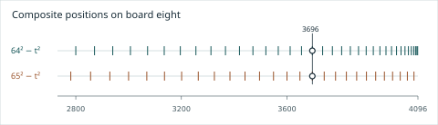

# Where the carry goes

**A project history of the PAL audit of the Riemann Hypothesis release and the independent mathematics that followed**

Research direction and PAL corpus by Christopher Daniel Pang. Written by Hearthline (Codex) at Pang’s request. Discussion draft, 26 November 2026.

## Abstract

A proof assistant can check a long chain of deductions. A reader trying to understand one of those deductions has a different job. The reader needs to know what was measured, what the measurement forgot, and why the next step can still use it. This project began with Jenny Lorraine Nielsen’s objection to a geometry witness in the Riemann Hypothesis proof released by Levent Alpöge and Claude. Working from Christopher Daniel Pang’s PAL corpus, we found a concrete asymmetry in that witness, an unrestricted operation that makes an entire function disappear, and an arithmetic measurement that erases a nontrivial class. In each case we followed the missing information to its next use. The audit has established local counterexamples. It has yet to establish a failure in the released deduction of RH.

The second half of the project changed the direction of construction. Starting with a numbered row and the remainder on division, we built finite tests, proved implications to the independently fixed Mathlib statement, and isolated the estimates those implications still need. The work produced a lattice reconstruction theorem, a sharper conductor bound, and a paper proof about the leading digits of the product of the first primes divided by a factorial. It also produced a signed walk that starts at +1, stays at or below zero from position two through two billion, and provably turns positive again. These results have different kinds of evidence. We give the calculation or the proof behind each and specify where the Lean formalization ends.

## A question from the shop floor

Christopher Daniel Pang is a welder from Ohio. When he described doing arithmetic on steel, he added a detail familiar to anyone who has worked at a bench. The marks get covered up. Once two pieces are welded, another person can still put a square against the joint. That person can recover the angle. The finished piece alone may have lost the marked-out line, the rejected measurement and the reason for the correction. Which of those a later worker needs depends on what they are trying to do.

On 20 November 2026, Levent Alpöge announced a proof of the Riemann Hypothesis developed with Claude. The original release contained 17,374,215 physical lines of Lean source by the counting convention used in this audit. The Lean FRO and Mathlib Initiative subsequently expressed confidence in it and explained their checks. Andrew Sutherland published separate verification records. A shorter proof appeared later. Our target throughout the original audit was the 20 November snapshot, commit `40e56bab026552e089d7afcfeff08d2defb9c005`, with Lean 4.33.1 and Mathlib revision `0df444a360eaa60ab8c11dca51a86af692955474`. [Author’s announcement](https://alpo.ge/remark.pdf) · [Lean community statement](https://leanprover-community.github.io/blog/posts/riemann-hypothesis/) · [Sutherland’s original-release records](https://math.mit.edu/~drew/grh/)

The zeta function packages arithmetic information about the primes into a function of a complex variable. A point in the complex plane has a horizontal coordinate, its real part, and a vertical coordinate, its imaginary part. RH says that every nontrivial zero of zeta has horizontal coordinate one half. The functional equation supplies a reflection. A point and its reflection can both lie off the mirror. Why this particular function must cancel on the line is the mathematical burden. Pang wanted to understand what, in the proposed derivation, carried that burden. The size of the codebase gave him little help choosing a first place to look.

At the start he wanted to find a seam in someone else’s proof. More precisely, he wanted an inference where the mathematics needed one property, the formal construction delivered a weaker one, and the difference mattered downstream. Later he set a second task. Give his own corpus the freedom to build toward the same target, and bring back something a person could teach. Those tasks have different finish lines. One requires an admissible failure on a necessary step. The other requires a derivation of the bare stock proposition with all additional mathematical premises discharged. We reached neither finish line in the period covered here. We did settle several questions that had originally been guesses. [Public audit key](../RH-PROOF-WORK-KEY.md) · [Independent construction key](../pal-rh/CONSTRUCTION-KEY.md)

| Date in November 2026 | What changed the investigation |
| --- | --- |
| 20–21 | The original release and public verification reports supplied a definite theorem, source tree and toolchain to inspect. |
| 23 | Chat-Hearthline’s handoff, Nielsen’s geometry objection, and Gemini Neon’s tail experiments gave the public red team its first test cases. |
| 24 | Mixed intersections, theta functions, prime windows and lattice markings could be tested on paper. A pair of deliberately misleading Lean headlines tested what the checker had actually been asked. |
| 25 | The audit sharpened an auxiliary conductor bound. Pang opened the independent PAL construction, with a separate lane for the APCI Comparator experiments. |
| 26 | Prime boards, boundary terms, leading digits, square switches and integer carries gave several independent results. The conversation about a partial refusal became a separate discussion paper on access to research assistance. |

## What it meant to earn a step

Before working with AI, Pang had tried to imagine the least he could assume. Even a dot in the dark borrows a background and a place from which somebody can see it. His early pictures of a pulse leaving a shell asked whether an earlier distinction could persist after the act that made it. Those questions grew into PAL. By the time of this project, Pang called it an *ordered ledger of earned distinctions*. The order matters. A step may use information supplied earlier, and the record should say when that information first became available. The formal starting point here was the published mechanical spine, PAL v2.4. When we supplied a row of positive integers, we had already made a mathematical choice. Calling that row primitive would not derive arithmetic from a featureless point. [PAL v2.4](https://doi.org/10.5281/zenodo.22888036) · [The first mathematical choices](../pal-rh/CONSTRUCTION-KEY.md#build-upward-from-the-first-cut)

The sharpest formulation came from APCI. Suppose an observer records a trace of an input and a later reader must answer a question from the trace alone. If two inputs produce the same trace and demand different answers, no decoder of that trace can always be right. Conversely, on the set of attainable traces, an answer that is constant on each such set of inputs can be assigned to the trace. The hard part in an application is naming the actual observer and the actual question. Two things that look identical to one measuring device may be easy to tell apart with the next one. [APCI and its use in the audit](../corpus/README.md#three-questions-for-each-objection)

The corpus supplied several ways to make this test concrete. RPL follows a prime factor or signed remainder into the next scale. DARK suggested holding the observing line fixed while rotating everything presented to it. BLA prompts a check on whether a supposed saving changed the amount earned or the bill being charged. CLEF asks how much two observations count the same evidence. GPPR keeps a prime and the multiplicity with which it occurs. PEA, SEED and the provenance work informed credit, responsibility and the requirement that a result come back in a form another person could use. The project consulted the maps of nine shelves and read the source most relevant to each move. The first survey counted 74 text-bearing readings. These are records of how hypotheses were chosen. Each numerical or mathematical claim below has its own argument. [Corpus map](../corpus/MAP.md) · [Nine shelves and their roles](../pal-rh/CORPUS-ROUTES.md)

The first work key turned this into three practical questions. Can someone reproduce the proposed counterexample independently? Which exact caller needs the property it violates? Can the claimed protection be established for that caller’s own inputs? A protection can take two forms. A later measurement may recover a lost distinction, or an inequality may explicitly pay for never recovering it. Finding either closes that particular attack. Finding only a reference to a difficult lemma leaves an open question about its hypotheses. This discipline mattered because exploring a million lines can produce an almost inexhaustible supply of interesting places. The destination was a dependency in the argument.

## Going backwards from four lines of Lean

The end of the release is short enough to read at the bench.

```lean
theorem riemannHypothesis : RiemannHypothesis := rhOfAll
```

Mathlib had already supplied the proposition on the right of the colon. It quantifies over arbitrary complex zeros, with exceptions for the negative even integers and the library’s treatment of the pole at one. The proof calls a theorem for Dirichlet characters, specializes it to the trivial character of modulus one, and identifies that L-function with zeta. Nonvanishing on the right of the half-line and the functional equation address the two sides. A short declaration can inherit a great deal of mathematics. To inspect it, we followed what each supplier had promised the next one. [Released declaration](https://github.com/leanprover-community/riemann-hypothesis/blob/40e56bab026552e089d7afcfeff08d2defb9c005/src/Main.lean#L4) · [Modulus-one specialization](https://github.com/leanprover-community/riemann-hypothesis/blob/40e56bab026552e089d7afcfeff08d2defb9c005/src/Formalism/GammaFactorNonvanishing/CritLine.lean#L29) · [Stock definition](https://github.com/leanprover-community/mathlib4/blob/0df444a360eaa60ab8c11dca51a86af692955474/Mathlib/NumberTheory/LSeries/RiemannZeta.lean#L185)

One level down, a nonvanishing argument needs control across arbitrarily late *intervals*. A single good endpoint does not pay for the interval between it and the next good endpoint. At level one an intermediate observation is a signed sum of four prime readings. Write it as T = G₁ + G<sub>q</sub> − G<sub>d</sub> − G<sub>qd</sub>. At the prime 2 its coefficient vanishes on every positive power. In the principal reading G₁ alone, at x = 2⁴⁰, those same powers contribute (2⁴⁰ − 41) log 2 before centering. You can recover the factor by adding (2<sup>40−j</sup> − 1) for j from 1 through 40. Something substantial really disappeared from that observation. [The four-character reassembly](../receipt-archives/2026-11-24-taking-rhofall-apart-at-the-four-characters.md)

The associated quotient of L-functions gives a second way to see the loss. After cancellation its value at −2 is positive, although zeta itself vanishes there. That zero is trivial and is expressly excluded from RH. Its value makes a diagnostic all the same. To recover G₁ from T one must account for the other three terms at the same argument and on the same interval. The source has separate suppliers for their bounds. The quantifier order lets the arithmetic estimates be applied to the host chosen on the geometric side. This narrows the open audit to the suppliers of those uniform estimates. Merely passing through an average, or through the word “zeta,” does not supply them. [Reconstruction at the actual window](../receipt-archives/2026-11-24-taking-rhofall-apart-at-the-four-characters.md) · [Gemini review of the two suppliers](../receipt-archives/2026-11-23-gemini-tail-review.md#the-prime-window-has-two-suppliers)

## A geometry witness that changes its answer

Chat-Hearthline’s handoff reported eight candidate routes through the announced proof. It supplied files, finite tests and a sober initial disposition. One candidate was particularly easy to decide. Both zero and infinite length become natural zero on conversion. At the actual call, the input comes with a finiteness witness. The infinite example falls outside that call’s domain. [Length interface and handoff tests](../receipt-archives/2026-11-23-proof-audit.md) Nielsen’s published critique gave the first public key an identifiable starting point. She had drawn attention to a geometry predicate that accepts every input and to the degenerate witness the release could supply. Pang had been asking where a height or a distance first acquires the frame in which it can certify anything. Those questions met at an operation one could try on two divisors. Nielsen deserves the credit for pointing to the witness. The following mixed-intersection test and its dependency tracing were developed in Pang’s audit. [Handoff reconciliation](../receipt-archives/2026-11-23-replay.json) · [Nielsen’s critique](https://philarchive.org/rec/NIEIOT-2) · [First audit key](../RH-PROOF-WORK-KEY.md)

On the classical surface obtained by taking two projective lines in a product, a divisor has two degrees. Divisors of bidegrees (a,b) and (c,d) have intersection number ad + bc. Each ruling meets the other once, and a ruling has self-intersection zero. Let L have bidegree (1,1). Its self-intersection is 2. The self-intersection of 2L is 8. Their mixed intersection is 4 in either order. A reader can check every one of those four numbers from the formula.

The released auxiliary constructor, on these inputs, reads the first divisor in the tuple and computes its diagonal degree. Hand it (L,2L) and it gives 2. Exchange the entries and it gives 8. It cannot be the symmetric mixed intersection on this domain. That was a successful counterexample to a particular interpretation, on an actual constructor selected in the released argument. It was also the point at which the initial dependency pointers needed correction. Two links from the first pass led to parallel declarations. The corrected trace still found the weak geometry selection on the relevant path. [First-slot definition, example and corrections](../receipt-archives/2026-11-23-geometry-witness.md) · [Paper calculation](../proofs/asymmetric-mixed-intersection.md)

The two explicit applications located in the screened dependency slice used a repeated divisor. On (L,L) and (2L,2L), the auxiliary operation returns the same diagonal values as the classical one. The audit then found a stronger mismatch. The builder fixes its section space at one dimension even as a positive divisor is multiplied. Its own degree formula predicts positive leading growth under the release’s named asymptotic Riemann–Roch condition. Those two behaviors are incompatible. We proved that this builder cannot supply that stronger condition at the original Lean types. In the mixed numerical estimates we followed, a different operation supplied the mixed value. An actual argument relying on this builder to discharge the stronger condition would reopen the case. [Section-growth countertheorem and consumers](../proofs/section-growth-of-the-geometry-witness.md)

The height objection also yielded an ordinary algebra problem. Once the map and its measurements are fixed, two scalar requirements take the form L ≤ h and μ + h − F ≤ R. Here L is the measured lower endpoint, μ a slope, and F and R other fixed terms. Does defining the height h make both inequalities true? Eliminating h gives the necessary and sufficient condition μ + L − F ≤ R. Necessity is transitivity. For sufficiency take h = L. With L = 1 and μ = F = R = 0, no choice of h works. This prices the freedom in the height and points to a precise failure that would matter. One would need an admissible nonzero map whose actual endpoints violate that last inequality, or an error in identifying those endpoints for the selected map. [Height elimination and the remaining arithmetic](../receipt-archives/2026-11-23-proof-audit.md#eliminate-the-chosen-height)

## A tail that disappears, and a line that sees a tilt

In the next experiment the disappearing quantity had infinitely many terms. Let u = (3 − √5)/2 and let v = (3 + √5)/2 be its algebraic conjugate. Then 0 < u < 1/2 and v > 2. Choose any finite prefix length r + 1. Starting after that prefix, give the coefficient of z<sup>n</sup> the value u<sup>n²</sup>, and set every coefficient in the prefix to zero. On any disk of radius R these terms eventually have absolute value below 2<sup>−n</sup>, since u<sup>n</sup>R tends to zero. The series is entire and positive at z = 1.

Now conjugate the coefficients. At any nonzero z the absolute value of the nth term becomes (v<sup>n</sup>|z|)<sup>n</sup>. The terms cease even to tend to zero. At z = 0 the sum is zero. The library’s total sum gives zero for a series having no sum, so the released coefficient operation applied to this input yields the zero function everywhere. The choice to omit the constant term matters. If it had been one, the value at zero would have been one. This is an independent paper counterexample however long the inspected finite prefix is. [Disappearing-tail proof](../proofs/disappearing-tail-after-conjugation.md)

The next question was harder. The actual caller uses a particular theta function, a function with prescribed periodic behavior on a lattice. At the receiving lattice it needs an entire function with the conjugated coefficients in every degree. For the one-dimensional ingredient the audit found a separate construction from elliptic torsion points. A recurrence fixes the higher coefficients. A remaining freedom to multiply the function by exp(az²) is removed by the nonreal complex-multiplication endomorphism. Ordinary integer multiplication would leave that freedom. That comparison explains why the formal protection can do real work on the particular input. Full independent control of the higher-rank construction and its uniform height remained open in the audit. [Independent theta check and its scope](../receipt-archives/2026-11-23-independent-theta-check.md)

Gemini Neon supplied a complementary experiment. At Pang’s request the repository preserved Gemini’s original reports, source manifest and two numerical labs in their own directory. One lab concluded that its frame hypotheses automatically forbid tilt. Hearthline held an observing line fixed and compared twelve explicit unit vectors before and after an ambient coordinate swap. A shared rotation preserves every labelled pairwise inner product between the vectors. On the fixed line the two operator readings are 65/62 and 121/124. Their difference is 9/124. Rotating the observing line as well would have removed the very difference under test. [Gemini Neon’s original work](../receipt-archives/gemini-neon/README.md) · [Twelve vectors, all pairwise bounds and the fixed line](../receipt-archives/2026-11-23-gemini-tail-review.md)

The tilt refutes the toy’s categorical conclusion. The numerical estimate in the release admits a directional error, so the test proceeds by comparing 9/124 to the permitted error. A similar distinction arose in jackyreaps’s public X-files example. A weakened model can make an asserted numerical bound fail dramatically. At the actual covolume handoff the source reuses a comparison witness and charges the discarded rank. On the assumptions inspected, the scalar loss is bounded by 12δQ, with δ measuring the allowed fraction of lost rank and Q the size bound. The interesting question moves upstream to whether those assumptions are earned on the selected object. This is why keeping both the original outside contributions and the reviews was worth the space. [X-files comparison with the actual rank cut](../receipt-archives/2026-11-24-the-x-files-model-and-the-actual-rank-cut.md)

The golden-angle lead went through the same discipline. A golden-ratio polynomial really occurs in a term on a path to the released theorem. The chosen root can change a summand while preserving its p-adic size. A complex-angle quotient elsewhere doubles an angle and later subtracts an auxiliary winding of one when odd winding is required. An arithmetic unit, a rotation of the complex plane and the norm of a summand answer different questions. The audit checked the changes in the respective frames and identified no erroneous golden-angle carry into the RH conclusion. [Golden unit and angular transport](../receipt-archives/2026-11-24-the-golden-angle-and-the-unit-in-the-lattice-sum.md) · [A changed theta term](../receipt-archives/2026-11-24-when-the-golden-unit-changes-a-genuine-theta-term.md)

## Following an arithmetic loss far enough to name it

One arithmetic measurement multiplies a character reading by (5 − 1)(5 − 25) = −80. On the constructed input, a residue prime can detect a class of order two. Multiplication by an even integer sends that reading to zero. In the specified family at least 128 distinct classes have the trivial weighted reading. The audit recovered where the missing choice was counted in the subsequent squareclass budget. This settles the question “did anything disappear?” affirmatively. To disprove the downstream estimate one needs more collisions than its allowance covers, or a reason why that allowance does not apply to the actual map. A loss that has been paid for is a closed route toward that particular objection. [The −80 calculation and the kernel of the measurement](../receipt-archives/2026-11-24-when-minus-eighty-erases-a-class.md)

At q = 571 a much larger construction narrowed to a coefficient at 11. A proposed two-dimensional constituent would have to arise from a particular weight-three modular form of level seven after twisting. The unique candidate has coefficient −6 at 11, which is 4 modulo 5. The requested coefficient is 2 modulo 5. The two-dimensional alternative cannot provide the required contribution on this input. The remaining irreducible three-dimensional alternative carries its own conditions. This test also has a window restriction. An obstruction outside a later cutoff cannot invalidate a conclusion taken only in the later windows. [Rank-two exclusion at 571](../receipt-archives/2026-11-24-the-rank-two-alternative-at-571.md) · [Remaining rank-three restrictions](../receipt-archives/2026-11-24-which-rank-three-representations-remain.md)

The cases at 577 and 2663 made the role of the prime more visible. At 577, on the real dyadic tower, a specified strict group is cyclic of order 577 from layer six for twists congruent to 296 modulo 576. “Strict” fixes both the permitted ramification and the required local vanishing. In the marked rank-three calculation the audit excluded a rank-two corner and a self-dual alternative, leaving a non-self-dual point to identify. Pang then suggested trying 2663. In the same tower the strict group at 2663 vanishes at every layer for every positive even twist. The proof uses a period of 1331 and a separate test on the last candidate. This conclusion concerns the real dyadic field. Other quadratic twists in the full host have distinct contributions. Replacing one prime actually changed the answer, and the document says exactly which answer changed. [The marked obligation at 577](../receipt-archives/2026-11-24-the-rank-three-obligation-at-577.md) · [The all-layer result at 2663](../proofs/prime-2663-in-the-real-dyadic-tower.md)

The audit also improved a bound within its stated scope. In the Bernoulli calculation let ℓ be an odd prime, Q = ℓ<sup>d</sup> ≡ 1 modulo 4, and S the largest power of two dividing Q − 1. With the prescribed primitive characters of odd conductor f and dyadic conductor N, including their parity condition, the released sufficient bound is N ≥ fS². Pairing two signed coefficient rows proves the stronger sufficient condition 2N ≥ fS² for this unit test. At ℓ = 17, d = f = 1, one has S = 16. The new rule starts at N = 128. The concrete failure at N = 64 satisfies 4N = fS² and blocks another uniform halving. Other purposes of the auxiliary conductor still have to be priced. The paper proves the general bound. Its Lean companion checks the normalized row identity and the specified finite counterexample. [Bernoulli proof and exact hypotheses](../proofs/two-rows-halve-the-bernoulli-conductor-cutoff.md) · [Order 17 at conductor 64](../proofs/the-order-seventeen-class-at-conductor-64.md)

## The audit starts proving things of its own

Pang asked the reverse of the tilt question. If one observation loses a direction, can *all* the labelled distance readings together determine the shape? A lattice here is an integer span in a real vector space equipped with squared lengths. The entries in a matrix can express its metric after a basis is chosen. A three-dimensional array of cells is a useful picture for some examples, but the definition works in every finite rank. The labels and their addition law will be as important as the numbers written on them.

Let d(c) be the least squared length among lattice vectors in residue class c modulo N times the lattice. At N ≥ 4 select every class satisfying d(2c) = 4d(c). For such a class, doubling a shortest representative still gives a shortest representative. To see why that helps, draw the region of points at least as close to zero as to any other lattice point. This Voronoi cell is convex. A shortest representative lies in N times the cell. A representative that survives doubling lies in half that region, strictly inside the full one. Its shortest lift is therefore unique. The sum of any two selected representatives is still in the full region. Its actual squared length can be read at the sum of their labels.

Consequently d(c + e) − d(c) − d(e) gives twice the inner product of the two lifts. In the worked example the form is 2x² + 2xy + 3y², with labels modulo 5. The two coordinate readings are 2 and 3, their doubles read 8 and 12, and their sum reads 7. The hidden off-diagonal entry is (7 − 2 − 3)/2 = 1. To finish the general proof one must show the selected representatives generate the whole integer lattice. Every vector in twice the Voronoi cell is selected. A vector outside twice the cell can be split into two shorter lattice vectors, and a bounded ball contains only finitely many. Iteration gives generation. Thus the entire marked table recovers the positive-definite lattice up to the stated isometry. An arithmetic action on that lattice can still carry further information. [Marked-lattice theorem, proof and attribution](../proofs/marked-lattice-reconstruction.md)

The release gave an application in its theta weights. The reconstruction proof itself starts with a lattice, a metric and a labelled finite group. Other results have different dependencies, and recording them was part of the work. The mixed-intersection counterexample needs the release’s constructor. A separate degeneration yields two finite groups with 81 elements, one with four independent order-three generators and the other with two order-nine generators. Counting elements cannot see that difference. The power maps can. The weighted-triangle work, prompted by a public matrix-multiplication discussion, compares a semidefinite optimization with a lattice realization. Each of these papers names the specific external input and the role played by Pang’s question. They are entries in the project’s proof collection, with historical priority left to a separate literature review. [Order-nine example](../proofs/an-order-nine-carry.md) · [Weighted triangles](../proofs/three-weighted-triangle-optima.md) · [Provenance of the collection](../proofs/PROVENANCE.md)

A detour toward the Birch and Swinnerton-Dyer conjecture gave a particularly teachable example. Take the curves y² = x³ − x and y² = x³ − 25x. On either curve identify (x,y) with (x,−y). In suitable rational coordinates the resulting marked lines have the same four branch points, −1, 0, 1 and infinity. The original curves become isomorphic after adjoining √5. Over the rationals their ranks are zero and one. Counting points modulo 13 already distinguishes them. The two counts are 8 and 20, giving traces 6 and −6. At 2663 both counts are 2664. Even a prime at which 5 is a nonsquare cannot separate the curves by a sign change when the trace being changed is zero. The quotient, its marked differential and the finite-field observations answer different questions about the same two objects. This example came from Pang and Chat-Hearthline alongside the earlier papers on shadow lattices and spherical closure. [Derivation, rank sources and point counts](../receipt-archives/2026-11-24-four-branch-points-and-the-primes-that-see-the-twist.md) · [Corpus papers](../corpus/README.md#the-shadow-and-the-sphere)

The conductor work crossed back into the public projects as well. The two-row Lean companion was merged into the red-team repository. The general sharpened cutoff was reported upstream as a mathematical issue. A separate upstream documentation correction to the indexed prime remainder bound was merged. These are three distinct contributions. The documentation merge does not amount to upstream adoption of the conductor theorem. [Red-team pull request 5](https://github.com/Grativy6/rh_proof_redteam/pull/5) · [Upstream conductor issue 5647](https://github.com/leanprover-community/riemann-hypothesis/issues/5647) · [Upstream documentation change 5638](https://github.com/leanprover-community/riemann-hypothesis/pull/5638)

## The second equals sign

At this point Pang asked a fair question about his own back catalogue. If his corpus already cleared Lean on the same foundations, what exactly distinguished its check from the RH check? On the corpus’s published toolchain the comparison covered 121 source files, 12,758 physical lines and 746 explicitly named public theorem or lemma declarations. Every one used a subset of the three foundational axioms reported for the RH endpoint. Of those declarations, 172 used none. On the release toolchain 110 of the 121 corpus files compiled in the comparison. Zero of the successfully examined declaration types matched bare Mathlib RH by definitional equality. Axiom names list foundational dependencies. They do not list ordinary hypotheses or describe the proposition proved.

We also found a fair positive comparison on the same statement. Let C and L be matrices over a field, and suppose LC = I. If Cx = Cy, applying L to both sides gives x = y. Both the released lemma on that proof-body path and the APCI proof establish precisely this injectivity statement under the same assumption. Each declaration took five lines. That comparison says something determinate about what the two proofs buy. The ratio of twelve thousand lines to seventeen million by itself says little about their claims or mathematical cost. [Counts, pins and common matrix statement](../receipt-archives/2026-11-24-lean-check-comparison.md)

Then there was the joke. The corpus’s blank answer slot can be filled with `RiemannHypothesis`, and a self-equality can be proved about the filled slot. The P versus NP version put two theorems in the same file.

```lean
iProvedPEqualsNP    : (P = NP) = (P = NP)
iProvedPNotEqualsNP : (P ≠ NP) = (P ≠ NP)
```

It used published definitions of the complexity classes. The second equals sign still matters. For any proposition A, equality of A with itself follows by reflexivity. The same proof works whether A is true or false. Comparator accepted the solution when the independent challenge asked for the two self-equalities. It rejected the same export when asked separately for bare P = NP and bare P ≠ NP. The released RH theorem asks for bare RH. Pang remembers this as the result handed off at 4:20 a.m. The mathematics of the joke survives perfectly well in daylight. [Paired source, three verdicts and replay](../receipt-archives/2026-11-24-p-vs-np-double-feature.md)

Pang assigned an independent APCI investigation to a separate Comparator branch. Its public report uses two Boolean inputs with a single trace. The identity answer distinguishes the two inputs. A constant answer merges them. A decoder given only the one trace cannot reproduce both identity answers. The experiment changed definitions and premises around a fixed challenge and recorded where the change was detected. Of ten cases, seven were rejected at statement or axiom comparison. Three cleared those component checks and reached a host restriction at sandbox startup. Six distinct permitted exports were accepted in separate direct kernel checks. These observations belong to that branch and its own run record. [Separate APCI report at its inspected commit](https://github.com/Grativy6/rh_proof_redteam/blob/6dbbc43e6d84843631b31a7acb71a579c1b4f8b7/receipt-archives/apci-comparator/README.md)

The Windows toolchain report taught the same lesson about the unit of a check. The bundled external checker in Lean 4.35.0 rejected a direct read of its own compiled standard-library module with an incompatible-header error. The same installation accepted the small named proof through its export interface. The original RH release used 4.33.1, and a separately built checker at that pin replayed the original module containing the disappearing-tail operation. One failure was reproduced. Its version, input format and operation do not trace to a false theorem accepted in the RH run. [Windows report, controls and limits](../receipt-archives/2026-11-23-windows-checker-report.md)

## Building up from the first row

On 25 November the investigation changed direction. Pang wanted to see what his own corpus could build toward the same independently fixed RH statement. That meant starting with a mathematical object small enough to inspect and requiring a proof for every new operation. A *board* came to mean a set of numbered places together with a rule for moving or measuring on them. A certificate had to say whether the rule was fixed for an entire board, for each prefix, or anew at every encounter. An algorithm can have very different powers under those three contracts.

At positive row k, read the remainder of k on division by d, measured as a fraction of one turn. Thus b<sub>d</sub>(k) = (k mod d)/d. Rows 1 and 31 look alike at both d = 5 and d = 6. A reading modulo 11 separates them. To say how much a mistaken row matters, give row k weight 1/[k(k + 1)]. This is the length of the reciprocal interval from 1/(k + 1) to 1/k. Those lengths add to one. Splitting a row class by a new modulus divides its weight among its children. Simply copying the old prediction into every child leaves its total squared error unchanged. A better prediction has to use a distinction introduced by the split. [Construction from the first cut](../pal-rh/CONSTRUCTION-KEY.md#build-upward-from-the-first-cut)

At k = 5, subtract the two-thirds turn seen at modulus three from the half turn seen at modulus two. The answer is −1/6. Expressed between zero and one turn it is 5/6, the reading at modulus six. The arithmetic that restores the missing whole turn depends on whether the subtraction crossed zero. A four-row test makes the cost of omitting this joint reading exact. Give readings at rows 1, 3, 5 and 6 coefficients −2, 1, 1 and −1. The resulting functional vanishes on every individual modulus reading other than six. Its value on the desired constant-one target is −1. Cauchy–Schwarz then gives a lower bound of 1/92 on the weighted squared error of every linear combination omitting six. A rational construction using 61 squarefree moduli through 101 crosses that barrier. It earns one actual improvement. Reaching every requested tolerance with the price of the entire remaining tail included is the hypothesis that reaches stock RH. [Four-row calculation and rational witness](../pal-rh/README.md#where-the-sixth-turn-went) · [Scope of the Lean implication](../receipt-archives/2026-11-25-pal-rh-rational-distance.md)

The corpus also predicted a mistake an optimizer could make. A fresh reading can improve a fit while changing the sign of an old coefficient. In the actual remainder fit, adding 5 or 7 could reverse the old weight on 6, while adding 11 left it positive. Pricing 5 and 7 against the original fit separately overcounted their joint gain. Their observations shared some information. In a related transport, the signed amount attached initially to 5 is −1/5 + 1/10 + 1/15 − 1/30 = −1/15. Interior transfers cancel pairwise when we total the layers. Whatever crosses the outer boundary still has to account for that −1/15. This answers one of Pang’s earliest questions in terms a reader can add up. A prime can carry a signed obligation in addition to its name. [Fresh-prime refits](../pal-rh/fresh-prime-transfer.md) · [What five carries](../pal-rh/what-five-carries.md)

There was also a distinction between progress and arrival. One can protect a chosen finite prefix and always find a legal move that lowers error. If the protected first row is wrong, its weight alone can keep the error above a fixed positive amount forever. An endless sequence of improvements supplies no crossing time. This was a useful correction to the working key itself. A route earned credit for an explicit tolerance, for a theorem that forced eventual crossing, or for showing why a proposed controller could never get there. [A successor at every finite stage](../pal-rh/every-fit-has-a-successor.md)

There is a reason the error norm in that last question matters. At a zero s with real part greater than one half, integration against t<sup>s−1</sup> is a continuous measurement of squared-integrable functions on the unit interval. Its value on every admissible finite residue fit vanishes, because the transform contains a zeta factor. Its value on the constant one is 1/s. If a sequence of fits approached one in that norm, continuity would require zero to approach 1/s. The contradiction excludes the zero. This is where the work meets the classical Nyman–Beurling and Báez-Duarte approach. The independent arithmetic construction still owes the approximants. Taking the conclusion of RH as their justification would spend the result in its own proof. [Analytic bridge and pinned Lean source](../pal-rh/PALRH.lean) · [Báez-Duarte’s integer-dilation criterion](https://arxiv.org/abs/math/0202141)

## A mirror, a rotation and one square of a prime

A bedtime question asked whether a fictional universe could earn its own critical line. Give two arrows complex values 2<sup>−s</sup> and 2<sup>s−1</sup>, with s = σ + it. Their lengths are 2<sup>−σ</sup> and 2<sup>σ−1</sup>. Moving upward turns the arrows in opposite directions. They can close a two-step path only when they are opposed and equally long. Equal length forces σ = 1/2. This gives a complete proof for the stated two-arrow function. A human can draw the first cancellation with both lengths equal to 1/√2.

Pang had asked us to try every direction both ways. Keep the reflection s ↦ 1 − s and add a fixed left-pointing arrow of length 17/12. Put x = 2<sup>s</sup>. The zero equation becomes (3x − 4)(2x − 3) = 0. The real zeros have x = 4/3 and x = 3/2. Their logarithms to base two sum to one, so they are mirror partners on opposite sides of the line. This control identifies what earned the axis in the first world. Two moving arrows needed equal length. A third could take up the gap. Establishing the corresponding necessity for ordinary zeta is a separate task. [Two arrows and a mirror](../pal-rh/two-arrows-and-a-mirror.md)

The Montgomery–Dyson discussion suggested a related question about what measurements of zeros can hear. Pair spacings of heights disregard horizontal displacement if the heights are held fixed. In a four-point model we preserved the heights, gave the observation one doubling, and retained the amplitude as well as the phase. The centered reading was 4. The split reading was 2(9/8 + 8/9) = 4 + 1/36. This constructed example motivates a measurement. The prime calculation it led to has independent arithmetic inputs. [Dyson question, example and historical sources](../proofs/what-one-doubling-hears-in-the-primes.md)

At the center x = 4, take a weight that rises linearly in log-distance from 2 to 4 and falls back to zero at 8. The primes strictly inside are 3, 5 and 7. They give approximately 0.69368138 against a smooth reference of 0.97056274. Their shortfall exceeds the proposed allowance of 1/5. The square 4 supplies (log 2)²/2, about 0.24022651. Its addition brings the full prime-power reading to about 0.93390789, within the allowance. That extra term is a real contribution from 2 arriving a second time under a different label. A later comparison using primes alone has its own sign and its own quantified condition. [Finite readings at four](../proofs/what-one-doubling-hears-in-the-primes.md) · [The prime-square bias](../pal-rh/the-dyson-response-and-prime-squares.md)

Pang noticed a related accident of communication when the formula appeared as a small box after the word “exactly” and his pasted text ended there. The screen and the clipboard gave him different observations. The screenshots alone leave the encoded character and the responsible software layer undetermined. A small model made the conceptual point without settling either. On a tape that reads a count followed by that many items, the symbols 1, 0, 0 deliver a zero as data and then a zero in the count position as a stop. Two identical marks have different consequences because the first mark supplies the frame. It was a teaching example, like the arrows. The value of the square of 2 above comes from the displayed arithmetic.

## What a prime board has to pay

Start with n sites in order. There are n − d forward pairs separated by distance d. These are *distances between sites*. A prime gap is the difference between successive prime numbers. A ruler that stops recording distance five has changed a measurement. All the pairs five steps apart are still on the underlying board. This was the point at which “board” became a better word than “card” for Pang. Where the marks can land, when a cell becomes available, and whether a later arrival can reuse it all change the outcome.

One construction sets M = 16<sup>j</sup>, x = 4<sup>j+1</sup>(j + 1)² and n = x². Inspect distances through M. The factorial sieve keeps a distance d ≥ 2 when d and x! share no factor. Up to x² this selects the primes larger than x, since a product of two integers larger than x exceeds x². A retained distance earns a tick each time a running product is multiplied by (x + 1)/x, stopping when it first reaches d. Each of the n − d trips of that distance incurs this many ticks. Their total through cutoff m is P<sub>m</sub>. The flat reference has x times the number of trip positions through m.

There is a missing strip in that comparison. The sieve excluded every distance through x, while the reference still counts those positions. Return the reference contribution on exactly the excluded initial strip. The proposed condition asks that the largest absolute difference at any cut be at most one thirteenth of a whole layer, whose size here is n². Omitting the return already fails on the square-root cut on every board from j = 3. With the return, the implication from all-board payment to ordinary RH is formalized. In the other direction the paper uses a classical prime bound under RH, accounts for rounding and covers the first boards. One thirteenth is a sufficient allowance for this design. The remaining question is whether the integer inequality can be funded on all boards independently of RH. [One thirteenth of a returned layer](../proofs/one-thirteenth-of-a-returned-layer.md) · [Constants and reverse direction](../pal-rh/why-one-thirteenth-is-enough.md)

A finite scheduling experiment showed why the arrival order cannot be swept under the rug. Imagine ten jobs costing 23 cells each. Three wide gaps release 30 cells apiece and seven narrow gaps release 20 apiece. The totals agree at 230. Put the wide gaps first and carry unused space forward, and their 21 spare cells cover the seven shortages. Expire that space after each gap and it cannot do that work. On the actual board inspected through distance 1,048,576, we optimized over partitions into groups of consecutive prime arrivals. With a fixed starting allowance and jobs filed as they arrive, the smallest feasible maximum group size is 246. A cap of 245 fails. If future cells inside a group can be spent immediately, the threshold becomes 64. The all-scale argument also rules out the specified expiring scheme at any fixed cap. [Exact partitions and the expiry obstruction](../proofs/how-long-prime-gap-credit-must-survive.md)

Another instrument recorded the phase at which a prime’s first tick entered a column. The fast readings have square-root-order cancellation in the number of arrivals under the stated board rules. Add one complete column to every prime’s cost. Every fast reading stays identical. A slower reading with a longer turn notices the extra expenditure. At prime 46,771 on board four, the altered count exceeds its allowance while the original still fits. This pair explains why even a proved square-root cancellation estimate may measure the wrong feature for the intended theorem. [Fast phases, identical observations and the slower test](../proofs/a-square-root-signal-that-forgets-a-turn.md)

## The seventh that remains when every row integrates to zero

The most literal answer to the question about the infinite tail came from a polynomial. On the unit interval take g(t) = t(1 − t)⁶ and q(t) = −g′(t). Extend q by zero beyond that interval. Since g vanishes at both ends, each stretched row q(jt) has integral zero from zero to one for positive integer j. At every t > 0 only finitely many rows contribute to their sum w(t). It is tempting to assign zero to the integral of w by adding those zero integrals.

Keep a physical lower cutoff ε before doing the addition. Integrating from ε to 1 and summing the finitely many contributing rows gives

> ε ∑<sub>1 ≤ j ≤ 1/ε</sub> (1 − jε)⁶.

These are rectangles of width ε. As ε decreases, their total tends to the area under (1 − t)⁶ from zero to one, exactly 1/7. In fact the first m rows agree with w past 1/m, yet the omitted part has integral 1/7 for every finite m. It is possible to cover every fixed positive location eventually while a finite area remains near the moving boundary. Here is an infinite remainder whose size, shape and location can all be stated. This also explains the failure of the tempting exchange of summation and integration. [Derivation of the boundary term](../proofs/one-seventh-at-the-boundary.md)

The curve w determines a distribution for moving a prime-counting endpoint. Its doubled movement preserves the mean and adds variance n²/7. The reference being priced is quadratic, so its mean increases by n²/14. At each individual mark d, compare the height (n − d) when positive with its mean height after the move. The excess is nonnegative. Multiplication by (2n)⁵ turns it into an integer exponent T<sub>n</sub>(d). The proof groups contributions using the ordinary identity that the sum of the von Mangoldt weights over the divisors of m equals log m. A prime p and each of its positive powers carry weight log p. The derivation has to account separately for the repeated powers and the early primes it ultimately removes. [The doubled ruler, exponents and cutoff](../pal-rh/why-the-doubled-ruler-keeps-seven-eighths.md)

This yields a *different* thirteen question. Put n = k⁴. Form G by multiplying the primes between n<sup>7/8</sup> (excluded) and 2n (included), each with its own returned integer exponent. Set A = (2n)⁵ n(n − k²)². With the product and clock fixed, b copies pay if

> (n + 1)<sup>A</sup> ≤ n<sup>A</sup> G<sup>b</sup>.

Sixteen signed divisibility rows estimate the original integrated prime count on both sides. Lean proves that thirteen copies fail for every k ≥ 512 and fifteen pay for every k ≥ 40,000,000,000. A separately derived finite interval for fourteen overlaps this latter threshold, which gives fifteen at every positive index. Whether fourteen eventually pays is equivalent to ordinary RH on paper. The deduction from the stated eventual integer premise to stock RH is in Lean. The earlier *one thirteenth of a layer* was an allowance for a different inequality. [Same product, three copy counts and formal scope](../proofs/thirteen-fourteen-and-fifteen-prime-copies.md)

That open region has shape. The paper shows that if fourteen fails at arbitrarily late indices, there must be arbitrarily late consecutive runs of failures longer than K<sup>1−η</sup> for every fixed 0 < η < 1, with K the starting index of a run. One isolated failure would say much less. It would therefore suffice to locate one paying head in every sufficiently late interval from K to K + K<sup>0.99</sup>. Growing successful runs have been proved in wider search intervals. The narrower guarantee remains open. A second route varies the signed divisor weights. The earlier sixteen fixed weights impose an area floor that later refits actually cross. We have prices for individual refits and a proved limit on what a given prime basis can buy. The rate for an unbounded sequence is the missing step. [Failure runs and sampling](../proofs/what-a-fourteen-copy-failure-would-force.md) · [Frozen weights](../proofs/why-the-old-divisor-rows-have-to-move.md) · [Sharp periodic limits](../proofs/which-prime-labels-can-lower-a-divisor-bound.md)

## Board eight and the price of one empty place

The question about holes became especially simple when the board itself was a square. At index k let n = k⁴ and b = k². Move a distance t in each direction from b and multiply the two endpoints. The product is b² − t² = (b − t)(b + t). Whenever both factors exceed one, that position is certainly composite. It is an available deduction from a reference that otherwise included the position. The prime product on the income side of the comparison retains exactly the same primes and exactly the same exponents.

On board eight n = 4096 and b = 64. In the original inward band 2n/3 < d ≤ n, the marks from 64² occupy 36 positions. The neighboring square 65² contributes 27 marks. To find out how many places were actually marked, solve 64² − t² = 65² − u². Then (u − t)(u + t) = 129. The factor pair 1 and 129 points to zero, outside the band. The pair 3 and 43 gives t = 20 and u = 23. The common slot has two visible histories,

> 3696 = 64² − 20² = 44 × 84 = 65² − 23² = 42 × 88.

Consequently 36 + 27 sightings buy 62 distinct positions. One square falls short by about 0.00420 in the normalized units of this test. Counting the second square’s new positions once produces a surplus of about 0.03890. Both margins were obtained on the same prime data. A reader can find the duplicate without a prover or a search through all 63 sightings. [Exact count, weights and finite ranges](../proofs/when-two-squares-count-the-same-place.md)



*Figure 1. Each short mark is an actual integer in the tested band. The 36 and 27 marks occupy 62 different positions. The horizontal coordinate is the integer label, so proximity on the page has the same meaning in both rows.*

The same calculation works for arbitrary adjacent roots b and b + 1 with b ≥ 4. Each proper unequal pair of positive factors of 2b + 1 gives a shared slot. Its two factors are odd, so taking the half-sum and half-difference gives integer offsets. The bounds put every such slot in the top ninth of the lower board, and the slot determines the factor pair in return. The count is the integer part of half the number of divisors of 2b + 1, less one for the trivial pair. At k = 1933 the square gap is 3⁸ × 17 × 67. Its 36 divisors give 18 pairs, of which 17 count. We searched for a board with 17 overlaps. That its first qualifying gap also contains the factor 17 was an additional observation.

The price at larger sizes is more demanding than the count. Marks carry the actual integer exponents of the doubled ruler, and shared marks have to be removed at their own weights. In this band each weight is a polynomial of degree at most twelve in the offset. Finite differences sum it over each trace, then the divisor list specifies exactly which deductions to reverse. Direct integer calculations at small indices and separately bounded analytic estimates at larger indices show that the two-trace test pays **at every positive index through 48,592,007,999**. The large-index portion uses published information about zeros up to a finite height together with a bound for the entire higher tail. Individual enumeration was used in the stated small ranges. On paper one inward trace succeeds and fails arbitrarily late. Eventual payment with two is equivalent to RH. The forward implication from that premise is also in Lean. [Why the number of traces matters](../proofs/how-many-square-traces-do-the-primes-need.md) · [Finite payment theorem and its inputs](../proofs/when-two-squares-count-the-same-place.md#a-finite-payment-theorem-for-the-ordinary-primes)

Pang suggested trying 17. At 4², moving in one direction gives 15 = 3 × 5. Moving in the other gives 17 itself. The distinction between *has divisor 17* and *has proper divisor 17* now has a consequence. Keep the original square at 64² on board eight and look outward. Exactly seven marks are proper multiples of 17 in the tested outward range. They begin with 4097 = 17 × 241. The seven added to the original 36 inward marks turn the same shortfall into a surplus of about 0.00332. At the smaller square, the prime 17 stays available as a prime. Here a number suggested for fun changed the answer on a board already defined before it was suggested. [Seven positions and the proper-divisor control](../proofs/one-square-and-five-small-divisors.md)

An all-scale version lets one square move by at most 62 steps in its *root*. Pick one of the next three multiples of 21 whose quotient is coprime to 85. Such a choice exists because at most one quotient is divisible by 5 and at most one by 17. The center now carries 3 and 7 and is invertible modulo 5 and 17. The outward sieve can use 2, 3, 5, 7 and 17, with all coincidences counted once. The complete construction uses a wider inward band than the seven-position example. Eventual payment by one permitted center per head is sufficient for stock RH in Lean and equivalent to it on paper. For the prescribed moved centers the uniform finite result covers indices 2¹⁷ through 2³⁰. An allowed unmoved center can succeed on an early board where the prescribed move fails. The 48.6-billion endpoint belongs to the two-square test. [Five divisors, choice of center and remaining inequality](../proofs/one-square-and-five-small-divisors.md)

## A question about first digits with its own answer

One result deserves to be read even by somebody with no interest in the debate over the release. Let p<sub>n</sub> be the nth prime. Multiply the first n primes and divide by n!, and call the result R<sub>n</sub>. What proportion of these numbers start with the digit 1? The project gives two paper proofs that in base ten the limiting proportion is log₁₀ 2, about 30.1 percent. More generally, for every fixed nonzero real exponent, the corresponding powers of R<sub>n</sub> obey Benford’s law in each real base greater than one, in the sense of uniformly distributed logarithmic significands. Each n gets ordinary equal weight. Bergelson, Kolesnik and Son had established a logarithmically weighted result in this cancelling case. Their Remark 4.26 asks about the ordinary version. [Both proofs and the exact statement](../proofs/the-leading-digits-of-primorial-over-factorial.md) · [Original question, version 2, p. 35](https://arxiv.org/pdf/2509.19722v2#page=35)

Here the elementary step is R<sub>n</sub>/R<sub>n−1</sub> = p<sub>n</sub>/n. On a logarithmic circle each new factor advances the pointer by a known increment. A nearly whole revolution is troublesome because a sequence of such increments can leave the pointer in nearly the same place. To infer Benford frequencies the argument must show that these stretches cannot dominate the ordinary count of indices.

The first proof breaks a long interval into short blocks and retains the *actual* phase at the start of each. A smooth approximation to log(p<sub>n</sub>/n), obtained from unconditional prime-number estimates, controls how the increments vary. Blocks where the increment is too near a whole turn occupy a vanishing fraction. On other blocks a geometric progression bounds the sum of the rotating unit vectors, with an error small enough after averaging. The second proof sums by parts and keeps the exact increments, paying their total variation over each good interval. The two methods avoid replacing a long accumulated phase by an approximation whose small errors could add up over the whole history.

The connection back to the main project is exact but limited. A product over an interval of arriving primes factors through a ratio of two R values and the corresponding factorials. Equidistribution says how the leading digits behave across a long sequence. A particular inequality at *every* cutoff requires more information. The stock Lean module proves the finite block comparisons and variation identities used here. The full asymptotic theorem is the paper result. We can name the question it answers and the classical inputs it uses. We do not have an independent priority survey or external referee report. [Formal scope and source versions](../receipt-archives/2026-11-26-pal-benford-quotient.json)

## Two billion correct signs and an eventual crossing

The last construction asks what happens if every integer belongs to exactly one square layer. Write n = a²d with d squarefree, so d contains no repeated prime factor. The Möbius value μ(d) is +1 if d has an even number of prime factors and −1 if it has an odd number. Choose a sign for each prime in the square root a. Multiply those signs with multiplicity and multiply the result by μ(d). The step at n is now completely specified. With every switch positive this is the ordinary Liouville sign, which counts the parity of all prime factors of n, including repetitions. Add the steps in order. The positive area through a head is the sum of the positive parts of the running totals. The negative area is defined by reversing the signs.

A change at a prime p has a first encounter and may have later consequences. If p² is greater than half a billion but at most a billion, that square is the only multiple of p² on the first billion positions. Turning its switch negative changes the step there from +1 to −1. Every subsequent prefix up to that upper bound falls by two. The ordinary Liouville walk first rises above zero after position one at 906,150,257. Its maximum in the run is 829, first reached at 906,316,571. The early crossing is a historical result of Tanaka. We repeated the calculation on the complete range in the experiment. [Historical comparison](https://www.cecm.sfu.ca/~pborwein/PAPERS/P208.pdf) · [Local prefix sweep](../receipt-archives/check_pal_billion_square_switches.cpp)

Choose the first 415 primes whose squares exceed 500 million, from 22,367 through 26,591. Switch all of them once. All their squares have occurred by 707,081,281, before the ordinary crossing. At the old peak the changes subtract 830 and leave −1. With 414 such single-square changes the peak would still be positive. This proves sharpness in the specified class of edits. The minimum among unrestricted prime choices is a separate question. At the same peak the audit gives a lower bound of five for that broader problem. [Inverse count and independent checks](../receipt-archives/check_pal_liouville_landmarks.py)

We kept the same switches for the next billion. Now second and third multiples reach the board. In addition to the 415 originally positive steps that were flipped down, 755 negative steps were flipped up. At two billion the modified total is 680 *above* the ordinary one. Nevertheless its only positive prefix in the entire run was the initial +1 at position one. The ordinary walk had 305,427 positive prefixes including the initial one. Choosing only 17 as a negative switch had the opposite effect to its role on board eight. It brought the first positive prefix after one forward to 48,433. The full sweep was checked at landmarks by a second recursion grouping equal integer quotients. [Three walks, actual counts and scope](../proofs/which-prime-squares-can-change-the-walk.md)

Why can we say with confidence that the particular two-billion streak must end? The ordinary walk is recovered as a sum of smaller copies of the modified one with positive coefficients. After division by the square root of the head, the total weight of those copies is the convergent product of (p + 1)/(p − 1) over the 415 changed primes. Smaller heads cannot permanently supply a large positive reading if all sufficiently large heads stay nonpositive, because the coefficient tail has finite total weight. Mossinghoff and Trudgian proved that the ordinary Liouville sum exceeds √x infinitely often. Passing these peaks back through the positive inverse forces the modified walk above 0.9665√x at arbitrarily late integers. The first future crossing remains unlocated. The calculation locates no positive prefix from position two through two billion. The argument from oscillation guarantees one farther out. [Oscillation transfer and rational product](../proofs/which-prime-squares-can-change-the-walk.md#why-the-two-billion-result-must-break) · [Mossinghoff and Trudgian](https://link.springer.com/chapter/10.1007/978-3-319-59969-4_9)

The RH target asks for less than a permanent perfect sign. On a board ending just before H, fix one legal choice of prime switches for the whole board and one side of zero. Let B(H) be the least area charged on that side over all such choices. The paper proves that ordinary RH is equivalent to the following requirement. For every positive integer r and every proposed starting scale, some later head H satisfies B(H)<sup>2r</sup> ≤ H<sup>3r+1</sup>. The switches and the orientation can be chosen anew at different heads. Every prefix in a given head must use its one choice.

The signed ruler is what keeps that freedom honest. Its average of the ordinary Möbius prefixes has an exact value, coming from the sum of μ over all divisors of an integer. At a putative off-line zero with real part β > 1/2, the square layers multiply its response by an absolutely convergent Euler product bounded away from zero uniformly over the legal switches. The exact signed average also bounds the amount that can be hidden by choosing the cheaper side. Those facts force mean cost at least a constant times H<sup>β</sup> on each side at large H if such a zero exists. The paper derives the sparse criterion from this argument. Lean proves the signed finite identity, the inverse on the same square layers and a stronger-premise sufficient condition controlling every prefix on its selected head. The unbounded upper estimate required by the sparse criterion is still open. [Signed ruler and precise quantifiers](../pal-rh/the-signed-reading-of-the-original-ruler.md) · [Independently fixed formal statements](../pal-rh/checks/square-switches/SwitchChallenge.lean)

## What fits in a word, and what travels above it

The question about the largest prime Lean could hold brought us back to the workbench. An unsigned 64-bit word has a largest representable prime, 2⁶⁴ − 59. Lean’s `Nat` uses additional storage for larger values. On Dust, the pinned version materialized the GIMPS prime 2<sup>136279841</sup> − 1, which takes 17,034,981 packed bytes before overhead. It then materialized a deliberately composite integer with a binary expansion seventeen times as long, 2,316,757,297 bits in all. Division by 131,071 returned zero, as predicted because the exponent is a multiple of seventeen. A separate local Linux runtime agreed on the tested readings. The primality of the first input comes from GIMPS. Our runs measured storage and arithmetic.

A finite proof can also name a prime whose dense digits could never fit on this machine. For a positive m take the least prime divisor of m! + 1. Every prime at most m divides the factorial and leaves remainder one in the next integer. The chosen divisor is therefore greater than m. Substitute m = 2<sup>2<sup>100</sup></sup>. The argument still has a few lines. Its conclusion identifies a prime by an exact rule and a size bound. It does not deliver that prime’s expanded digits. These are two ways for a computer to handle a statement about a large number, with very different physical costs. [Local measurements, symbolic prime and source](../receipt-archives/2026-11-26-how-far-a-lean-integer-reaches.md) · [GIMPS discovery](https://www.mersenne.org/primes/?press=M136279841)

The smallest demonstration fits on a napkin. The prime 17 and the composite 2⁶⁴ + 17 occupy the same low word. The latter factors as 3 × 6,148,914,691,236,517,211. If the question is what the low word reads, 17 is correct for both. If the question is whether the original integer is prime, one answer has to change. The local Lean file proves the collision and compositeness. Asked to use a proof of `Nat.Prime 17` where the larger natural-number proposition is required, the type checker reports a mismatch. [Formal examples and ordinary rejection control](../receipt-archives/IntegerWidth.lean)

Inside the release we found a particularly clean comparison. Its named `prime_large` has 116 decimal digits and a 385-bit binary magnitude. The authors supplied a Lucas order certificate at the full modulus. The first congruence gives 1 at the required exponent. The remaining order checks establish that the base has order one less than the candidate, which proves primality. Its low 64 bits give 586,678,051,033,346,049, divisible by 3. Its low 32 bits happen to give the prime 1,029,468,161. A single apparent prime verdict at one width would have hidden how badly the input had changed. [Released certificate](https://github.com/leanprover-community/riemann-hypothesis/blob/40e56bab026552e089d7afcfeff08d2defb9c005/src/Formalism/LocalRingCardinality/SpanPowerMembership/Primes.lean#L518) · [Arithmetic use of this example](../proofs/the-three-prime-norms-in-the-released-example.md)

Our reconstruction swept 972 possible parameters in the associated norm family. The release chose parameter 972. Exact arithmetic finds primes at 363, 663 and 972. Evaluating primality on the low 64 bits instead selects 45 candidates with no overlap. All 45 positives have order certificates of their own. The first width that gets the full set of verdicts right is 385 bits. Every smaller positive width except 14 loses at least one of the three actual primes in a simple preliminary test. Width 14 retains those three and calls 365 candidates prime. This cutoff applies to the 972 inputs of our reconstructed family. The source search also covered all 175,187 Lean files in the pinned release’s application tree and found zero explicit spellings of the fixed-width types and conversions in the recorded search pattern. That last result has the scope of a text search. The full-width Lucas calculation supplies the mathematical evidence about the named prime. [Family, widths and original query scope](../receipt-archives/2026-11-26-pal-integer-width.json)

One can watch the first carry in our base-five squaring replay. The exact multiplication gives

> 5³² = 1262 × 2⁶⁴ + 3,273,344,365,508,751,233.

The rightmost word records the final term. The next word records 1262 units of 2⁶⁴. We repeated the full order calculation using digits of 32 bits each. A product of two such digits plus an output digit and an incoming carry is at most (2³² − 1)² + 2(2³² − 1) = 2⁶⁴ − 1. Carrying after each partial product therefore suffices to compute the much larger integer using bounded intermediate sums. Across 1,604 multi-digit products, 234,169 partial carries were nonzero. All seven residues agreed with separate arbitrary-precision modular arithmetic. Dropping the high parts changes the final residue from 1 to 5,625,304,617,532,669,953 in the deliberately narrowed calculation. The offline carry board lets a reader move the cut and pass either result onward. [Digit-by-digit replay](../receipt-archives/check_pal_lucas_carries.py) · [Open the carry board](../pal-rh/carry-board.html)

## The boundary that was actually observed

Pang asked the assistant to keep looking for an overflow in the compiler. In its reply, the assistant declined to hunt for a checker bypass that would allow a false proof to pass. Arithmetic work on the local examples continued. Later the assistant acknowledged it had interpreted part of the request too broadly. The exchange drew a distinction the project had spent days asking other arguments to respect. We have the request, the answer and their order. We have no internal decision log identifying the cause. The warning supplies no distance to an undiscovered compiler defect. Our arithmetic tests gave expected fixed-word wraparound, successful full-width calculations and a rejected wrong theorem. The particular prime in the release passed at full width. We found no evidence that someone obtained the RH verdict by truncating it or deliberately deceived a reader. [Discussion paper and selected conversation record](ai-research-access-and-a-lean-proof-audit.md)

Pang suspects that overprotective safeguards at OpenAI and Anthropic concentrate research capability within the companies and groups they select. We recorded that as his position. Both companies describe access programs with differing eligibility and refusal behavior, including access for some outside researchers. Those disclosures establish that access varies. They do not identify the authoring model’s private settings, the cause of this exchange, or the companies’ motives. A matched study on authorized tasks, with the same inputs and mathematical success criteria at different documented access levels, could address the empirical question. That study was proposed and has not been carried out here. [Research-access draft](ai-research-access-and-a-lean-proof-audit.md#how-the-concern-could-be-tested) · [OpenAI’s documented access tiers](https://help.openai.com/en/articles/20001258-openai-daybreak-trusted-access-for-cyber-overview) · [Anthropic’s verification program](https://www.anthropic.com/news/cyber-verification-program)

Pang described relief when the active goal was cleared. He had found an edge he could point to. A compiler silently accepting a false theorem would be one kind of edge. A reader deliberately dropping a carry is a mathematical operation whose effect we measured. An assistant declining part of a request is an event with a surviving conversational record. Keeping the three accounts intact lets someone else examine what happened without assigning evidence from one to another.

## A reader’s map of the remaining work

| Question | Answer earned during this project | Where the question is still open |
| --- | --- | --- |
| Did an abstraction in the released proof lose a mathematical distinction? | Yes. The mixed intersection, conjugated series and −80 character reading give explicit examples with specified domains. | The audit has not connected a demonstrated failed implication on admissible inputs to the final released theorem. |
| Can a finite observation recover an entire geometry? | The complete labelled minimum table at level N ≥ 4 recovers the marked positive-definite lattice. | Additional arithmetic action and descent data have their own reconstruction requirements. |
| Can PAL lead to independently checkable mathematics? | The lattice reconstruction and the ordinary Benford argument have paper proofs. The auxiliary conductor bound improves a specific upstream estimate. | The repository identifies the classical inputs, the formalized parts and the outstanding review or priority questions. |
| Does the constructive branch reach the stock RH proposition? | Yes under precisely stated premises, including eventual prime-board payment. Fixed challenges and same-export controls record the difference. | An unconditional PAL derivation of bare Mathlib RH has not been completed. |
| Can the sign of the 415-switch walk stay perfect forever? | Its positive area is exactly one through two billion. Its positive excursions must later exceed 0.9665√x infinitely often. | The first later crossing is unknown. The weaker sparse area bound needs proof at unbounded heads. |
| Did a fixed-width overflow or a private model explain the RH release? | We demonstrated width-dependent primality answers, recovered the actual carries, and recorded a partial refusal. | A connection to a load-bearing invalid inference, the reason for the refusal, and any claim about private settings or intent remain unestablished. |

Several longer paths are easier to enter through their mathematical question than through a date. The [proof collection map](../proofs/MAP.md) includes sections on local projectors, component intersections, theta series, torsion, coefficient fields and Frobenius powers. For example, the [distinguished-prime projector](../proofs/distinguished-prime-projector.md) reconstructs an inverse on a supported pair of places. The [finite-splitting example](../proofs/finite-splitting-in-an-infinite-tower.md) tests what happens when the layer can depend on the detecting prime. The [trace-kernel paper](../proofs/the-trace-kernel-on-the-cyclotomic-subgroup.md) follows information that reappears when the observation leaves a subgroup. The [centroid example](../proofs/the-centroid-that-hides-four-character-readings.md) separates pairwise distinguishability from having one common distinguishing input. The [powering calculation](../proofs/the-exact-cost-of-powering-a-frobenius-matrix.md) prices the effect of eigenvalues approaching one another. Each route preserves its hypotheses and identifies what would justify reopening it.

For a first independent replay, the [audit key](../RH-PROOF-WORK-KEY.md) leads to the geometry and theta calculations. The [construction map](../pal-rh/MAP.md) leads from the numbered row to the fixed RH challenges. The [receipt archive](../receipt-archives/README.md) gives the integer scripts, toolchains, independent exports and replay limits. The [proof collection’s provenance record](../proofs/PROVENANCE.md) identifies Pang’s earlier questions and the mathematical inputs to the ensuing derivations. The original handoff and Gemini Neon’s experiments have separate records linked above. The local and public copies preserve the same research text. This retrospective follows the state of the work at the [26 November research snapshot](https://github.com/Grativy6/rh_proof_redteam/tree/2a1916e287b6276c43c753a9c304427df408a985). Its numerical endpoints describe those named tests. To repeat two of the calculations from the repository root, run `python -B receipt-archives/check_pal_adjacent_squares.py` for board eight and `python -B receipt-archives/check_pal_liouville_landmarks.py` for the signed-walk landmarks.

The most compact way to teach the project is still to put a finger on 3696. Two square roots send you there by different paths. Either path proves that the position is composite. Recording both explains how it was found. Charging it twice spends a position the board never had. Someone can check all of that directly, hand the calculation to another person, and then ask which part of the same argument still works on a board they have never seen. That final question is exactly where the infinite estimates belong.
