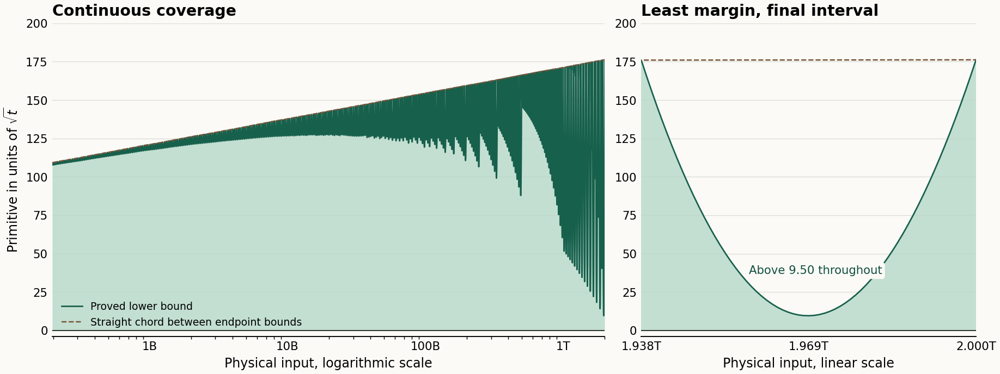

# One quantity at each fourth power

Christopher Daniel Pang and Hearthline, 25 November 2026 (New York). Pang asked what must travel from one frame to the next. In the PAL construction, all the earlier marks can be accumulated in a single piecewise-linear function. Its value at one physical head now gives an independently fixed conditional implication to stock Mathlib RH.

**It suffices to prove that $B(2j^4)\ge0$ for every sufficiently large integer $j$.** In fact a fixed debt $B(2j^4)\ge-Cj^2$ is affordable. We prove $B(t)>0$ on the full real interval $1<t\le2{,}000{,}000{,}000{,}000$. This covers the first 1,000 positive root indices. The restriction to sufficiently large $j$ in the theorem remains an open arithmetic obligation.

## Build the number by hand

For $v=2^i3^k$ and $(d,6)=1$, place a mark $a(v^2d)=v\mu(d)$. All other marks are zero. Let
$$
 B(t)=\sum_{n\le t}a(n)(t/n-1),\qquad W(t)=\sum_{n\le t}a(n)/n,\qquad M(t)=\sum_{n\le t}a(n).
$$
Then $B(t)=tW(t)-M(t)$. When $t$ reaches an integer $n$, its mark adds a slope of $a(n)/n$ to the graph of $B$. Its initial contribution to the height is zero. Thus $B$ is continuous and affine between consecutive integers.

For instance $B(4)=3$. At $t=8$ the contributing labels are $1,4,5,7$ and their marks are $1,2,-1,-1$. Hence $B(8)=7+2-3/5-1/7=289/35$. The previous first-pass reading at 4 is recovered as $(B(8)-B(4))/4=46/35$.

At every real $x>0$ the relation is $x S_1(x)=B(2x)-B(x)$. The earlier test asked for a lower bound on this **difference** at a fourth power. A lower bound on $B$ at one point cannot be subtracted from another lower bound to establish it. The new deduction uses the one-point lower bound in a different way.

## Why the one-head floor suffices

The Dirichlet series of the actual $a(n)$ is
$$
 A(s)=\frac{1}{\zeta(s)(1-2^{-s})(1-3^{-s})(1-2^{1-2s})(1-3^{1-2s})}.
$$
For $\Re s>1$ integrate each linear ramp directly to get
$$
 \int_1^\infty B(t)t^{-s-1}\,dt=\frac{A(s)}{s(s-1)}. \tag{1}
$$
The integral and the series are absolutely convergent there. The pole of ordinary zeta at 1 gives $A(1)=0$, canceling the apparent pole from $s-1$. On the real interval $1/2<s<1$, the alternating eta series gives $\zeta(s)<0$. The four smooth factors are nonzero there. Thus the right side of (1) extends analytically across every real $s>1/2$. A zeta zero with real part greater than $1/2$ would give it an actual pole. [Ordinary zeta expansions](https://dlmf.nist.gov/25.2) · [Source of the four factors](why-one-large-prime-leaves-nine.md)

Suppose $B(t)\ge-C'\sqrt t$ on $t\ge1$. The Mellin integral of $B(t)+C'\sqrt t$ has a nonnegative integrand on the real axis. Such an integral has a singularity at any finite real abscissa of convergence. Indeed, expansion about a real point just to its right turns a small leftward Taylor displacement into a sum of nonnegative logarithmic moments. If an analytic disk crossed the abscissa, monotone convergence would sum those moments to a convergent integral to its left, a contradiction. Formula (1) plus $C'/(s-1/2)$ therefore gives convergence and holomorphy throughout $\Re s>1/2$. The hypothetical pole is excluded, and the functional equation reflects the remaining nontrivial zeros to the same line. [Reflection formula](https://dlmf.nist.gov/25.4)

Fourth powers suffice for that bound. Across a gap $(l,r]$ the only bending of the graph comes from labels inside it. The chord error in absolute value is at most $(r-l)\sum_{l<n\le r}|a(n)|/l$. The elementary count of smooth roots gives $\sum_{l<n\le r}|a(n)|\ll r-l+\sqrt r\log(2r)$. Consecutive doubled fourth powers have $r-l\asymp l^{3/4}$, so the error is $O(\sqrt l)$. Finite initial gaps cost a fixed constant. This establishes the paper implication, including the allowed negative margin.

The Lean proof reaches the same conclusion through the project’s area estimates. Summing $2^{-i}S_1(x/2^i)$ telescopes at each integer label to $B(2x)/x$. Subtracting half of the preceding half-scale sum recovers $S_1(x)$ exactly. The area norm costs at most a factor of two in this recovery. A one-sided bound for the telescoped function controls its absolute area using the project’s signed rectangle estimate. Interpolating in reciprocal coordinates puts the fourth-power floor into this implication. [Area and return](../pal-rh/PALRH/OneHead.lean) · [Fourth-power interpolation](../pal-rh/PALRH/OneHeadSamples.lean) · [Rational physical number and stock RH implication](../pal-rh/PALRH/OneHeadPhysical.lean)

## What forces positive values at unbounded heads?

There is an unconditional lower bound on the positive excursions of the actual primitive:
$$
 \limsup_{j\to\infty}
 \frac{B(2j^4)}{\sqrt{2j^4}\log(2j^4)}
 \ \ge\ c_*,\qquad
 c_*=\frac{-4}{\zeta(1/2)(1-2^{-1/2})(1-3^{-1/2})\log4\log9}
 \in[7.26410105,7.26410106].
$$
Each square factor has a simple zero in the denominator at $s=1/2$. Taking the coefficient of $(s-1/2)^{-2}$ on the right of (1) gives $c_*>0$. To prove the limsup claim, suppose instead that for some $0<c<c_*$ the primitive is eventually bounded above by $c\sqrt t\log t$. Use the same nonnegative-integral argument on $c\sqrt t\log t-B(t)$, adding a bounded compactly supported correction at small $t$. Its real Mellin integral converges for $s>1/2$, but its leading coefficient as $s$ decreases to $1/2$ is $c-c_*<0$. A nonnegative integral cannot have that limit after multiplication by $(s-1/2)^2$. The chord error between adjacent root samples is $O(\sqrt t)$ and the two endpoint scales have ratio tending to one, so the same lower bound holds along the sampled roots. The finite calculation of $c_*$ encloses the alternating eta value by its Euler transform with a geometric tail. [Exact coefficient calculation](../receipt-archives/check_pal_fourth_primitive.py)

This earns arbitrarily late positive samples. The theorem still needs enough control of the negative side between them. Another sufficient direction is that $B(2j^4)/(2j^4)$ eventually never increases. Indeed $B(t)/t=W(t)-M(t)/t\to0$ by the ordinary cofactor estimates. An eventually nonincreasing sequence converging to zero is nonnegative from that point on. The change between consecutive physical heads $a<b$ has an especially short formula:
$$
 \frac{ab}{b-a}\left[\frac{B(b)}b-\frac{B(a)}a\right]
 =M(a)+\sum_{a<n\le b}a(n)\frac{a(b-n)}{n(b-a)}. \tag{2}
$$
Only the single signed integer $M(a)$ carries in from the preceding head. Everything else is a mark newly met on that interval. Equivalently the left side is $ab/(b-a)$ times $\int_a^b M(t)t^{-2}\,dt$. The proved analytic limit here follows from (2) of the [cofactor paper](why-one-large-prime-leaves-nine.md). Whether these consecutive changes can be controlled at unbounded heads is open.

## Every input through two trillion

The green curve shows how far the primitive is proved to stay above zero between endpoints. Its dips show the possible inter-endpoint error allowed by the calculation. The right panel magnifies the interval with the least guaranteed margin. The dense initial scan extends from 1 past the left edge of the figure.

1. Through $200{,}000{,}000$ every physical mark was included in order. Two integer prefixes enclose $W(t)$ using reciprocal rounding at scale $2^{80}$. The harmonic prefix stayed greater than $0.00438403$ throughout its positive-integer domain in this scan. Thus $B(t)$ is strictly increasing there. The rough stream before the square pass also had positive primitive throughout that scan, yet its primitive is already strictly negative at $10^{12}$. The actual square-pass primitive at $10^{12}$ exceeds 171 million.
2. For the higher range we computed 327 endpoint enclosures. At each quotient-grid head two divisor recurrences determine the ordinary rough signed mass and harmonic mass. One uses all ordinary multipliers with the smooth source. The other uses just multipliers coprime to six and the unit source. They used different sieve cutoffs and agreed on all signed counts. Summing the smooth squares gives the physical $M$ and $B$ at each endpoint.
3. There is a deterministic bound between any two such endpoints. At $t=(1-h)l+hr$, $0\le h\le1$, the chord of the single ramp $(t-n)_+$ exceeds it by at most $(r-l)h(1-h)$ and agrees exactly for $n\notin(l,r)$. Only positive marks can lower the actual graph below the chord. If $P$ bounds their total magnitude on $(l,r]$, then
   $$
    B(t)\ge (1-h)B_{\rm low}(l)+hB_{\rm low}(r)
             -h(1-h)(r-l)P/l .
   $$
   Count candidate rough cofactors by excluding multiples of 2 and 3 and the squares of 5, 7, 11 and 13. This gives an upper bound $U$ on the absolute mass in that interval. Then $P=\lfloor[U+M(r)-M(l)]/2\rfloor$ is sufficient. The right-hand quadratic is minimized by rational arithmetic on $[0,1]$.

The 326 panels cover every point from **196,562,611 through 2,000,000,000,000**, overlapping the dense initial scan. Even the weakest panel proves $B(t)>9.50094\sqrt t$. At its far endpoint the interval tightens to **249,169,893.2973 through 249,169,964.7959**. On each of the 326 panels $B(r)/r<B(l)/l$. This last result concerns the two ends of each panel. The positive floor applies to every point inside. [Full endpoint record and reproduction](../receipt-archives/2026-11-25-pal-one-head-primitive.json) · [Integer scan](../receipt-archives/fourth_primitive.cpp) · [Continuum bound](../receipt-archives/check_pal_primitive_mesh.py)

The fixed challenge independently specifies $v\mu(d)\max(0,2j^4/(v^2d)-1)$ over the actual ordinary labels. Its conclusion is stock Mathlib RH under eventual nonnegativity of that rational sum. Linux Comparator accepted the solution with all three configured kernels. The arithmetic proof of the continuous finite interval is documented separately above. [Mathlib-only challenge](../pal-rh/checks/one-head/OneHeadChallenge.lean) · [Solution against the challenge](../pal-rh/checks/one-head/OneHeadSolution.lean) · [What four earlier readings can predict](../pal-rh/what-two-neighboring-blocks-predict.md)
